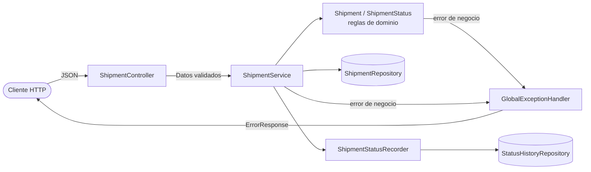
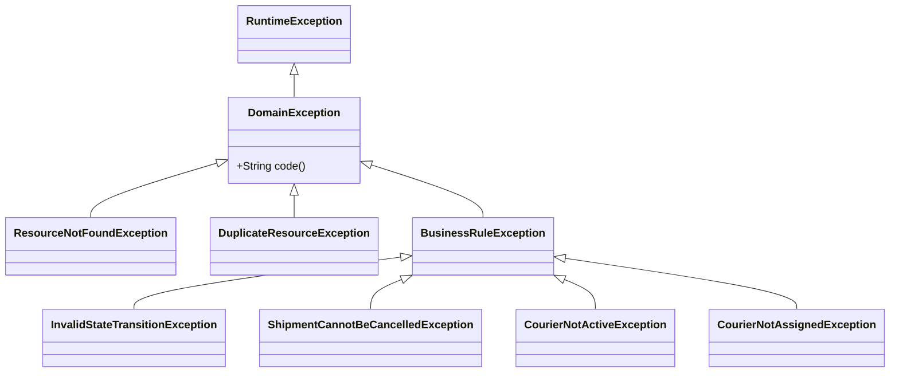
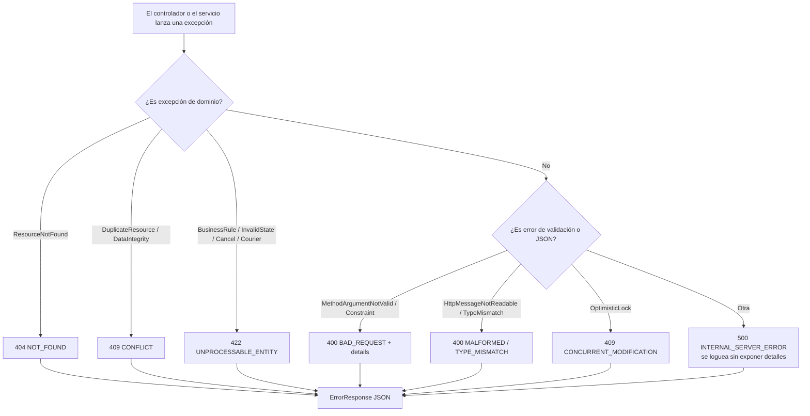
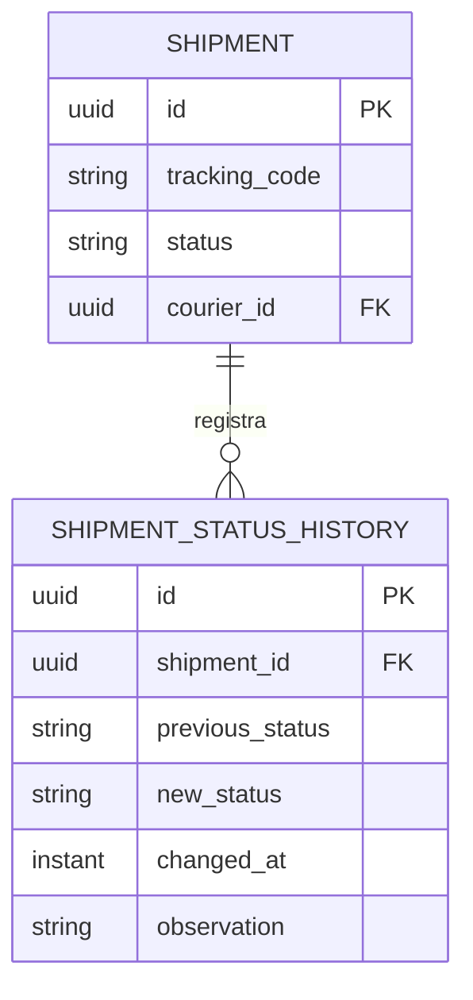
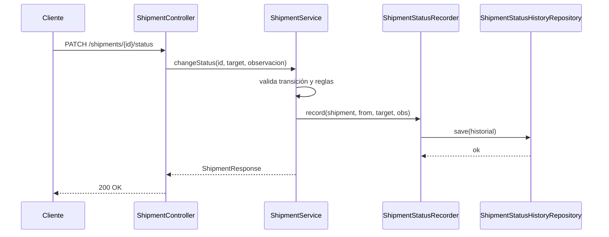
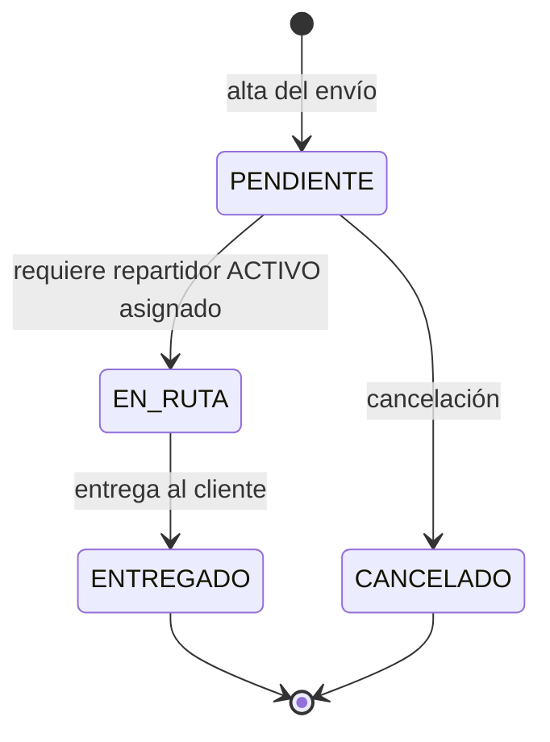
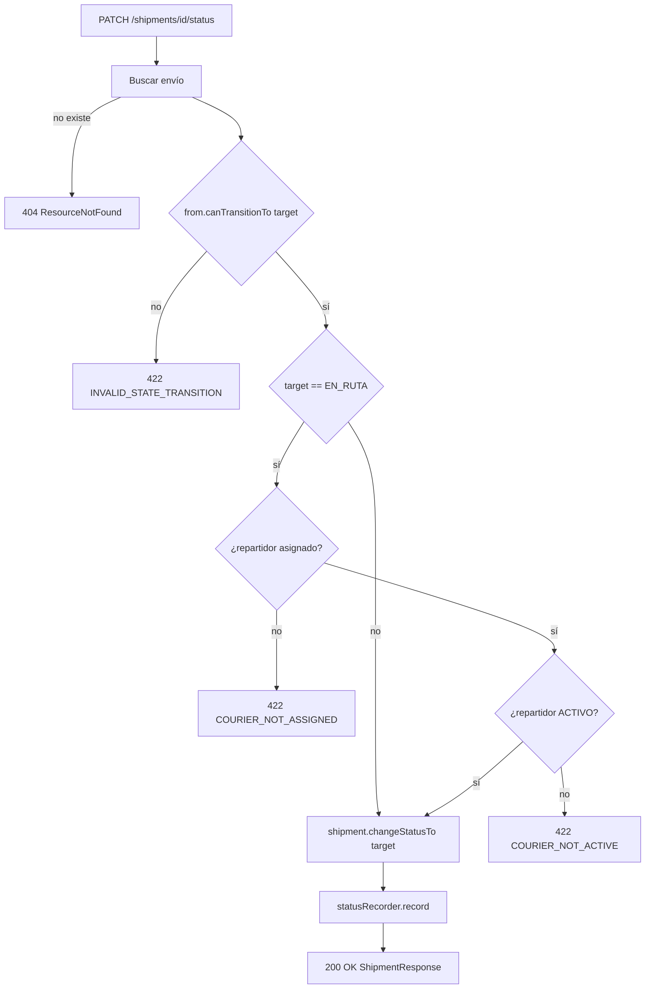
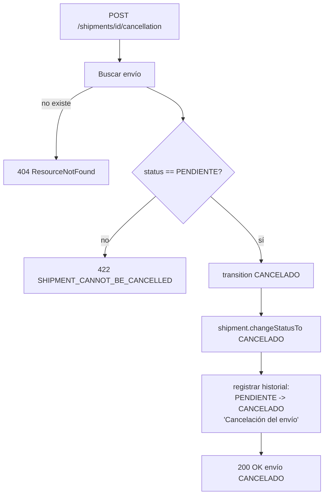
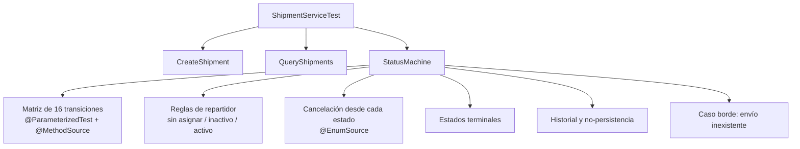

# Issues implementadas — GonzaCarrillo

Documento de cierre de las issues de `shipment-service` a cargo de **Gonzalo Carrillo**.
Explica qué se hizo, cómo funciona el código y el flujo de cada funcionalidad, con
diagramas de estados y de flujo.

| # | Issue | Tipo | Rama | Estado |
| --- | --- | --- | --- | --- |
| 6 | Manejo de excepciones globales y contrato de error | `feature` | `feature/6-global-exception-handler` | Mergeada en `main` (PR #42) |
| 21 | Historial de auditoría de estados | `feature` | `feature/10-status-history` | Implementada (rama) |
| 22 | Máquina de estados y `PATCH /shipments/{id}/status` | `feature` | `feature/11-state-machine` | Mergeada en `main` (PR #51) |
| 23 | Cancelar envío (solo `PENDIENTE`) | `feature` | `feature/12-cancel-shipment` | Mergeada en `main` (PR #51) |
| 29 | `ShipmentServiceTest`: máquina de estados, cancelación y asignación | `test` | `test/18-shipment-service-state-machine` | Mergeada en `main` (PR #52) |

---

## 0. Panorama general

El servicio está organizado en capas. Todas las issues de este documento atraviesan
`controller` → `service` → `entity` / `repository`, y comparten la jerarquía de
excepciones de dominio y el historial de estados.



Conceptos transversales:

- **Excepciones de dominio** (`DomainException`) desacopladas del transporte HTTP.
- **Contrato único de error** (`ErrorResponse`) para todas las respuestas de error.
- **Trazabilidad**: cada cambio de estado genera una fila en `shipment_status_history`.
- **Reglas en el dominio**: la máquina de estados vive en el enum `ShipmentStatus`,
  no en controladores ni servicios.

---

## 1. Issue #6 — Manejo de excepciones globales

### Qué se hizo

- Se creó la jerarquía de excepciones de dominio con un código de negocio (`code()`).
- Se implementó `GlobalExceptionHandler` (`@RestControllerAdvice`) que traduce
  excepciones de dominio y de framework a respuestas HTTP coherentes.
- Se definió `ErrorResponse` como contrato único de error.
- Se agregó una suite `@WebMvcTest` que verifica cada mapeo.

### Jerarquía de excepciones



### Flujo de conversión de una excepción



### Tabla de mapeo

| Excepción | HTTP | `code` |
| --- | --- | --- |
| `ResourceNotFoundException` | 404 | `RESOURCE_NOT_FOUND` |
| `DuplicateResourceException` | 409 | `DUPLICATE_RESOURCE` |
| `InvalidStateTransitionException` | 422 | `INVALID_STATE_TRANSITION` |
| `ShipmentCannotBeCancelledException` | 422 | `SHIPMENT_CANNOT_BE_CANCELLED` |
| `CourierNotActiveException` | 422 | `COURIER_NOT_ACTIVE` |
| `CourierNotAssignedException` | 422 | `COURIER_NOT_ASSIGNED` |
| `BusinessRuleException` (genérica) | 422 | `BUSINESS_RULE_VIOLATION` |
| `MethodArgumentNotValidException` | 400 | `VALIDATION_ERROR` |
| `ConstraintViolation` / `HandlerMethodValidation` | 400 | `CONSTRAINT_VIOLATION` |
| `HttpMessageNotReadableException` | 400 | `MALFORMED_REQUEST` |
| `MethodArgumentTypeMismatchException` | 400 | `TYPE_MISMATCH` |
| `DataIntegrityViolationException` | 409 | `DATA_CONFLICT` |
| `ObjectOptimisticLockingFailureException` | 409 | `CONCURRENT_MODIFICATION` |
| `Exception` (no controlada) | 500 | `INTERNAL_SERVER_ERROR` |

### Contrato `ErrorResponse`

`timestamp`, `status`, `error`, `code`, `message`, `path` y `details` (lista de
`{ field, message }`, omitida cuando está vacía).

```json
{
  "timestamp": "2026-10-19T12:00:00Z",
  "status": 422,
  "error": "Unprocessable Entity",
  "code": "INVALID_STATE_TRANSITION",
  "message": "Transición de estado inválida para Envío: ENTREGADO -> CANCELADO",
  "path": "/api/v1/shipments/550e8400-e29b-41d4-a716-446655440000/status",
  "details": []
}
```

**Clave de diseño:** el controlador de excepciones es el único punto que conoce
HTTP. Las capas de negocio solo lanzan `DomainException` con su código.

**Archivos:** `controller/GlobalExceptionHandler.java`, `dto/ErrorResponse.java`,
`exception/*.java`, `test/.../GlobalExceptionHandlerTest.java`.

---

## 2. Issue #21 — Historial de auditoría de estados

### Qué se hizo

- Entidad `ShipmentStatusHistory` (append-only) que guarda `previousStatus`,
  `newStatus`, `changedAt` y `observation`.
- Servicio `ShipmentStatusRecorder` con propagación `MANDATORY`: solo registra
  dentro de una transacción existente, garantizando atomicidad.
- Endpoint `GET /api/v1/shipments/{id}/history` con DTO y mapper.
- Tests del recorder, del servicio y del controlador.

### Modelo



Las columnas de historial son `updatable = false`: la tabla es inmutable, funciona
como bitácora de auditoría.

### Cuándo se registra



El alta del envío también deja historial: `ShipmentCreator` registra
`(null → PENDIENTE, "Alta del envío")` dentro de su transacción con
`Propagation.REQUIRES_NEW`.

### Endpoint

| Método | Ruta | Resultado |
| --- | --- | --- |
| GET | `/api/v1/shipments/{id}/history` | Lista cronológica (`changedAt ASC`) de cambios |

- `404` si el envío no existe (se valida con `existsById` antes de consultar).
- Respuesta: `id`, `previousStatus`, `newStatus`, `changedAt`, `observation`.

**Archivos:** `entity/ShipmentStatusHistory.java`,
`repository/ShipmentStatusHistoryRepository.java`,
`service/ShipmentStatusRecorder.java`, `dto/StatusHistoryResponse.java`,
`mapper/ShipmentStatusHistoryMapper.java`, `service/ShipmentCreator.java`.

---

## 3. Issue #22 — Máquina de estados y cambio de estado

### Qué se hizo

- La regla de transiciones vive en el enum `ShipmentStatus` (`canTransitionTo`).
- `Shipment.changeStatusTo` valida y aplica el cambio en la entidad.
- `ShipmentService.changeStatus` orquesta validación de repartidor + historial.
- Endpoint `PATCH /api/v1/shipments/{id}/status` documentado con OpenAPI.

### Diagrama de estados



Tabla de transiciones (16 combinaciones, 3 permitidas):

| Desde \ Hacia | PENDIENTE | EN_RUTA | ENTREGADO | CANCELADO |
| --- | --- | --- | --- | --- |
| **PENDIENTE** | No | Sí | No | Sí |
| **EN_RUTA** | No | No | Sí | No |
| **ENTREGADO** | No | No | No | No |
| **CANCELADO** | No | No | No | No |

### Flujo de `changeStatus`



Detalles:

- `ShipmentService.transition(...)` es el **único camino** para cambiar estado
  (lo reutiliza la cancelación).
- Ante error, el envío no se persiste ni genera historial: las validaciones
  ocurren antes de `changeStatusTo` y `record`.
- El historial se registra con `from` y `target`, permitiendo reconstruir la línea
  de tiempo.

**Archivos:** `entity/ShipmentStatus.java`, `entity/Shipment.java`,
`service/ShipmentService.java`, `dto/ChangeStatusRequest.java`,
`controller/ShipmentController.java`, `controller/GlobalExceptionHandler.java`.

---

## 4. Issue #23 — Cancelar envío (solo si está `PENDIENTE`)

### Qué se hizo

- `ShipmentService.cancel(id)` reutiliza `transition(...)` con destino `CANCELADO`.
- Excepción específica `ShipmentCannotBeCancelledException` (422) que informa el
  estado actual.
- Endpoint `POST /api/v1/shipments/{id}/cancellation` con OpenAPI.
- La cancelación **no elimina** el envío y **conserva** el repartidor asignado.

### Flujo



### Cancelar vs. cambiar estado

| Aspecto | `changeStatus` | `cancel` |
| --- | --- | --- |
| Entrada | estado destino elegido por el cliente | destino fijo `CANCELADO` |
| Estados de origen | válidos según la máquina | únicamente `PENDIENTE` |
| Error de origen inválido | `INVALID_STATE_TRANSITION` | `SHIPMENT_CANNOT_BE_CANCELLED` |
| Observación por defecto | la envía el cliente | `"Cancelación del envío"` |
| Efecto sobre el repartidor | — | lo conserva |

Ambas rutas terminan en el mismo método privado `transition`, por lo que comparten
validaciones, registro de historial y mapeo de respuesta.

**Archivos:** `service/ShipmentService.java`,
`exception/ShipmentCannotBeCancelledException.java`, `controller/ShipmentController.java`.

---

## 5. Issue #29 — `ShipmentServiceTest`

### Qué se hizo

Se reorganizó `ShipmentServiceTest` en bloques `@Nested` y se agregó el bloque
`StatusMachine`, que concentra la cobertura de la máquina de estados, la
cancelación y las reglas de repartidor. Se consolidaron allí los tests que antes
vivían en `ChangeStatusTest` y `CancelShipmentTest` (eliminados) para evitar
duplicación.

### Estructura de la suite



### Cómo funciona la matriz

`transitions()` genera las 16 combinaciones **origen × destino** y calcula si la
transición está permitida. El test verifica, para cada caso:

- **Permitida:** cambia el estado y se invoca `statusRecorder.record(...)`.
- **Rechazada:** lanza `InvalidStateTransitionException`, el estado no cambia y
  no se toca el historial.

```mermaid
flowchart LR
    A[transitions: 4x4 = 16 casos] --> B{¿permitida?}
    B -->|sí| C[verifica nuevo estado + record()]
    B -->|no| D[verifica excepción + estado intacto + sin historial]
```

### Qué cubre el bloque `StatusMachine`

- Las **16 transiciones** de la tabla (3 válidas, 13 inválidas).
- `EN_RUTA` sin repartidor → `CourierNotAssignedException`.
- `EN_RUTA` con repartidor inactivo → `CourierNotActiveException`.
- `EN_RUTA` con repartidor activo → éxito.
- Cancelación desde los 4 estados (solo `PENDIENTE` permitido).
- Estados terminales (`ENTREGADO`, `CANCELADO`) sin transiciones.
- Un cambio rechazado **no persiste** (`save`/`saveAndFlush` nunca se invocan).
- La cancelación **conserva** el repartidor asignado.
- Envío inexistente → `ResourceNotFoundException` sin historial.

> La asignación de repartidor (#24) ya estaba cubierta por `AssignCourierTest`, por
> lo que no se duplicó.

**Archivos:** `test/service/ShipmentServiceTest.java`.

---

## 6. Verificación

```shell
./mvnw verify        # suite completa + JaCoCo
mvn javadoc:javadoc  # validación de la documentación
```

- Todas las ramas de estas issues terminaron con `BUILD SUCCESS`.
- Cobertura: `target/site/jacoco/index.html`.
- La máquina de estados también está cubierta a nivel de dominio en
  `entity/ShipmentStatusTest` y a nivel HTTP en `controller/ChangeStatusControllerTest`
  y `controller/CancelShipmentControllerTest`.
