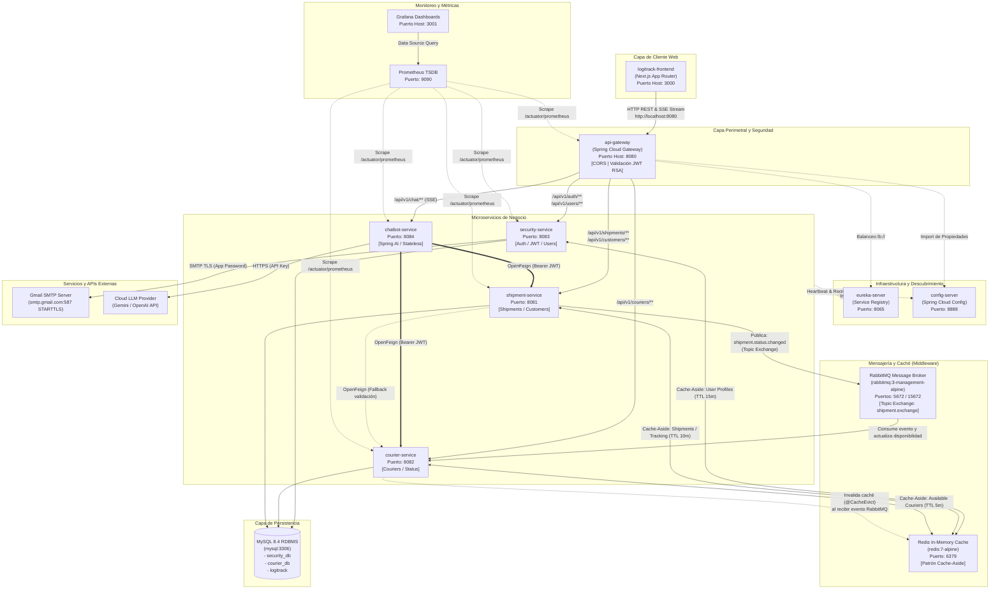
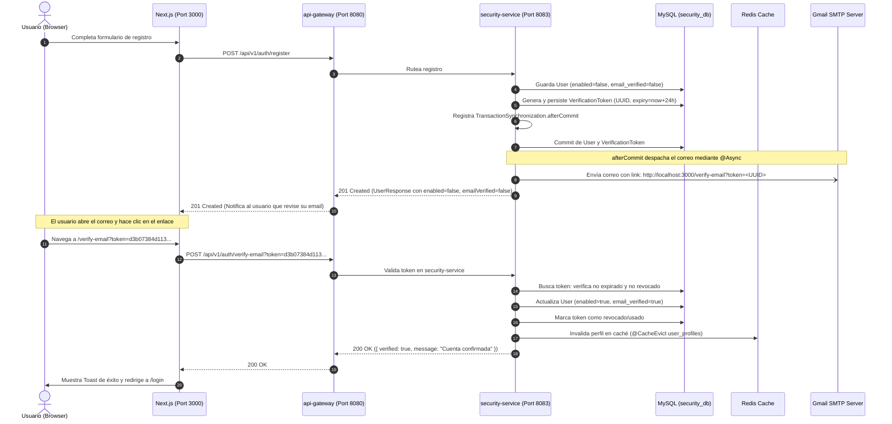
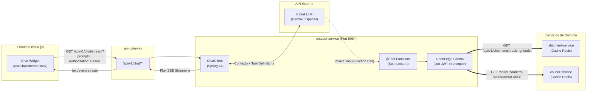

# Software Design Document (SDD) — Ecosistema LogiTrack
## Sprint 4: Integración Frontend Next.js, Expansión Agéntica y Observabilidad

**Versión:** 1.1.0  
**Fecha:** Noviembre 2026  
**Estado:** Aprobado para Implementación Multi-Repositorio  
**Autores:** Equipo de Arquitectura & Tech Lead LogiTrack  

---

## 1. Contexto, Objetivos y Alcance

### 1.1. Propósito del Documento
El presente documento de diseño de software (**SDD**) establece el marco de referencia arquitectónico, los estándares de comunicación y los contratos de interfaz entre el ecosistema distribuido backend (**LogiTrack**) y la nueva capa de cliente web desarrollada por el equipo de frontend (**logitrack-frontend** en **Next.js**).

Dado que el trabajo se distribuye entre múltiples colaboradores a través de repositorios independientes dentro de la organización de GitHub `logitrack`, este documento actúa como la **fuente única de verdad (Single Source of Truth)** para garantizar la sincronización técnica entre frontend y backend sin desvíos de contratos.

---

### 1.2. Objetivos del Sprint 4

* **Integración del Cliente Frontend:**
  * Implementar una aplicación web interactiva utilizando **Next.js (App Router y TypeScript)** ejecutándose en `http://localhost:3000`.
  * Configurar interceptores HTTP para la propagación del token JWT en cabeceras `Authorization: Bearer <TOKEN>`.
  * Implementar *Route Guards* y renderizado condicional de elementos de UI basado en roles/claims del usuario normalizados.
  * Manejar centralizadamente errores HTTP bajo el estándar **RFC 7807 (ProblemDetail)** y redirección reactiva ante estados `401 Unauthorized` / `403 Forbidden`.
* **Seguridad y Verificación (Feature 1):**
  * Habilitar el flujo de confirmación de registro mediante correo electrónico con enlaces transaccionales únicos (UUID con vigencia de 24 horas), integrado con el servidor SMTP de Gmail (`smtp.gmail.com:587`).
* **Inteligencia Agéntica (Feature 2):**
  * Diseñar y desplegar un nuevo microservicio independiente, **`chatbot-service`**, potenciado por **Spring AI** y conectado a un LLM Cloud (Gemini u OpenAI).
  * Exponer consultas seguras mediante `@Tool` (Function Calling) que consumen los microservicios de dominio a través de OpenFeign con propagación de credenciales JWT hacia hilos asíncronos.
  * Proveer respuestas asistidas en tiempo real hacia Next.js mediante **Server-Sent Events (SSE)**.
* **Observabilidad de Plataforma (Feature 3):**
  * Integrar recolección de métricas operativas con **Spring Boot Actuator** y **Micrometer Prometheus**, orquestando instancias de **Prometheus** y **Grafana** en Docker Compose para monitorear rendimiento, JVM, conexiones de base de datos y tasas de fallos.
* **Desacoplamiento y Optimización de Rendimiento:**
  * Implementar comunicación orientada a eventos mediante **RabbitMQ** (Topic Exchange) para sincronizar estados entre `shipment-service` y `courier-service`.
  * Implementar el patrón **Cache-Aside con Redis** en `security-service`, `shipment-service` y `courier-service`.
* **Orquestación End-to-End Multi-Repositorio:**
  * Empaquetar `logitrack-frontend` mediante un Dockerfile multi-stage optimizado (`output: 'standalone'`) e integrarlo al archivo unificado `docker-compose.yml`.

---

### 1.3. Glosario y Terminología de Dominio

| Término | Definición Técnica y Contexto en LogiTrack |
| :--- | :--- |
| **API Gateway** | Punto de entrada perimetral reactivo (`api-gateway`) en el puerto 8080. Responsable del enrutamiento dinámico, resolución de CORS y validación inicial de firmas JWT. |
| **Security Service** | Microservicio emisor de identidad (`security-service`). Administra credenciales, firma tokens JWT asimétricos con par de claves RSA (2048 bits) y gestiona los estados de los usuarios. |
| **Shipment** | Entidad raíz del servicio de envíos (`shipment-service`). Representa un paquete o carga asociada a un remitente/destinatario (`Customer`), un repartidor (`Courier`) y una dirección (`Address`). |
| **Courier** | Repartidor o transportista gestionado por `courier-service`. Posee estados de disponibilidad operativa (`AVAILABLE`, `BUSY`, `INACTIVE`). |
| **Chatbot Service** | Microservicio *stateless* (`chatbot-service`) basado en Spring AI. Actúa como agente conversacional consultor; no persiste datos propios e interactúa con otros servicios como cliente HTTP autenticado. |
| **Function Calling / `@Tool`** | Capacidad de Spring AI que permite al LLM invocar métodos predefinidos de Java con argumentos tipados para extraer información de negocio en tiempo real. |
| **SSE (Server-Sent Events)** | Protocolo unidireccional sobre HTTP (`text/event-stream`) que permite al backend enviar flujo de datos (*streaming*) hacia el cliente Next.js sin la complejidad bidireccional de WebSockets. |
| **RFC 7807 (ProblemDetail)** | Estándar formalizado para respuestas de error HTTP en APIs REST (`title`, `status`, `detail`, `instance`, `invalidParams`). Adoptado por Spring Boot 3 y base para notificaciones de error en el frontend. |
| **Standalone Output** | Modo de empaquetado de Next.js que compila solo los archivos y módulos de Node.js estrictamente necesarios para producción, reduciendo drásticamente el peso de la imagen Docker. |

---

## 2. Arquitectura Global del Sistema

### 2.1. Vista General de Arquitectura (Ecosistema Distribuido y Patrones Clave)

El ecosistema **LogiTrack** implementa una arquitectura de microservicios orientada al dominio logístico, gobernada por tres principios arquitectónicos fundamentales:
1. **Perímetro Seguro y Centralizado:** Todo el tráfico entrante desde el cliente web (`logitrack-frontend` en Next.js) ingresa exclusivamente por el `api-gateway`.
2. **Desacoplamiento Asincrónico (Event-Driven con RabbitMQ):** Las operaciones de cambio de estado operacional (despacho a reparto, entrega o cancelación) se notifican mediante eventos en un *Topic Exchange* de RabbitMQ, permitiendo que `courier-service` actualice reactivamente la disponibilidad de los mensajeros sin acoplamiento síncrono.
3. **Optimización de Lecturas (Patrón Cache-Aside con Redis):** Para evitar la degradación de la base de datos relacional ante ráfagas de lectura, se incorpora una capa de caché en memoria con Redis y políticas estrictas de expiración (TTL) e invalidación reactiva (`@CacheEvict`).



---

### 2.2. Topología de Red, Puertos y Enrutamiento

#### 2.2.1. Tabla Maestra de Puertos y Rutas (Referencia para Next.js)
El frontend en Next.js se conecta únicamente a través de la URL base del Gateway (`http://localhost:8080`).

| Servicio / Contenedor | Service ID (Eureka) | Puerto Contenedor | Puerto Host | Prefijo / Ruta en API Gateway | Responsabilidad Principal |
| :--- | :--- | :--- | :--- | :--- | :--- |
| **`logitrack-frontend`** | *N/A (Cliente)* | `3000` | `3000` | *N/A* | Aplicación web en Next.js (App Router). |
| **`api-gateway`** | `API-GATEWAY` | `8080` | `8080` | `/` | Enrutamiento perimetral, CORS y filtro JWT. |
| **`security-service`** | `SECURITY-SERVICE` | `8083` | `8083` | `/api/v1/auth/**`<br>`/api/v1/users/**` | Autenticación, registro, verificación por email y JWT. |
| **`shipment-service`** | `SHIPMENT-SERVICE` | `8081` | `8081` | `/api/v1/shipments/**`<br>`/api/v1/customers/**` | Gestión de envíos, clientes y publicación de eventos. |
| **`courier-service`** | `COURIER-SERVICE` | `8082` | `8082` | `/api/v1/couriers/**` | Repartidores, consumo de eventos de envío y disponibilidad. |
| **`chatbot-service`** | `CHATBOT-SERVICE` | `8084` | `8084` | `/api/v1/chat/**` | Asistente conversacional con streaming SSE. |
| **`eureka-server`** | `EUREKA-SERVER` | `8065` | `8065` | *N/A (Interno)* | Servidor de registro y resolución dinámica de nombres. |
| **`config-server`** | `CONFIG-SERVER` | `8888` | `8888` | *N/A (Interno)* | Servidor central de configuraciones (`config-repo`). |
| **`rabbitmq`** | *N/A (Broker)* | `5672` / `15672` | `5672` / `15672` | *N/A (Consola en :15672)* | Broker AMQP para mensajería asíncrona desacoplada. |
| **`redis`** | *N/A (Caché)* | `6379` | `6379` | *N/A (Interno)* | Almacén clave-valor para aceleración Cache-Aside. |
| **`mysql`** | *N/A (RDBMS)* | `3306` | `3307` | *N/A (Interno)* | Persistencia relacional (`security_db`, `courier_db`, `logitrack`). |
| **`prometheus`** | *N/A (TSDB)* | `9090` | `9090` | *N/A (Métricas)* | Recolector de métricas vía Actuator. |
| **`grafana`** | *N/A (Dashboard)* | `3000` | **`3001`** | *N/A (Observabilidad)* | Visualización de telemetría (puerto 3001 para evitar colisión con Next.js). |

---

#### 2.2.2. Matriz de Mensajería Asincrónica (RabbitMQ — Caso A)

Para mantener la consistencia estricta con las entidades y enums de dominio del sistema:
* **Exchange:** `shipment.topic.exchange` (Tipo: `topic`, durable: `true`).
* **Cola de Consumo:** `courier.shipment-status.queue` (durable: `true`).
* **Routing Key:** `shipment.status.changed` (o comodín `shipment.status.*`).
* **Payload Unificado del Evento (`ShipmentStatusChangedEvent`):**
  ```json
  {
    "eventId": "b7d2f9b8-18e3-4c92-b4ea-12051db52971",
    "shipmentId": "550e8400-e29b-41d4-a716-446655440000",
    "trackingCode": "LT-A1B2C3D4E5",
    "courierId": "7f9a1c2e-3b4d-4e5f-8a9b-0c1d2e3f4a5b",
    "previousStatus": "PENDIENTE",
    "currentStatus": "EN_RUTA",
    "occurredAt": "2026-11-05T22:00:00Z"
  }
  ```
* **Flujo Operacional y Reglas de Disponibilidad:**
  1. `shipment-service` procesa la transición de estado mediante `PATCH /api/v1/shipments/{id}/status` o cancelación.
  2. Mediante `RabbitTemplate`, publica el evento serializado en JSON en `shipment.topic.exchange`.
  3. `courier-service` recibe el mensaje mediante `@RabbitListener(queues = "courier.shipment-status.queue")`:
     * Si `currentStatus == "EN_RUTA"`: actualiza el estado del courier a `BUSY`.
     * Si `currentStatus == "ENTREGADO"` o `currentStatus == "CANCELADO"`: libera al courier a `AVAILABLE`.
  4. Acto seguido, `courier-service` ejecuta `@CacheEvict(value = "couriers_available", allEntries = true)` en Redis para que el listado de repartidores libres se mantenga 100% consistente.

---

#### 2.2.3. Matriz de Caché (Patrón Cache-Aside con Redis)

El patrón **Cache-Aside** opera bajo la siguiente premisa: el microservicio busca primero el recurso en Redis. Ante un *Cache Hit*, devuelve la información en sub-milisegundos. Ante un *Cache Miss*, consulta la base de datos relacional, escribe el resultado en Redis con su respectivo TTL y responde al cliente.

| Microservicio | Espacio de Nombres (Cache Name) | Patrón de Clave (Key Pattern) | TTL | Estrategia de Invalidación / Evicción |
| :--- | :--- | :--- | :--- | :--- |
| **`security-service`** | `user_profiles` | `user::username::{username}` | `15 min` | `@CacheEvict` al actualizar datos del usuario, cambiar contraseña o al verificar email. |
| **`courier-service`** | `couriers_available` | `couriers::available` | `5 min` | `@CacheEvict(allEntries = true)` disparado automáticamente al consumir el evento de RabbitMQ o al modificar un courier manualmente. |
| **`shipment-service`** | `shipment_queries` | `shipment::tracking::{trackingCode}` | `10 min` | `@CacheEvict` al cambiar el estado del envío (`changeStatus`) o asignar un courier. Facilita lecturas ultrarrápidas al `chatbot-service`. |

---

### 2.3. Estrategia de Configuración Centralizada

El servicio `config-server` provee la configuración en tiempo de arranque leyendo el repositorio local `config-repo`:
* **Parámetros de RabbitMQ:** Inyectados a nivel global (`spring.rabbitmq.host=rabbitmq`, `spring.rabbitmq.port=5672`).
* **Parámetros de Redis:** Inyectados centralizadamente (`spring.data.redis.host=redis`, `spring.data.redis.port=6379`).
* **Políticas de Perfil (`dev` vs `prod`):**
  * `dev`: Serialización JSON legible en RabbitMQ (`Jackson2JsonMessageConverter`), TTL acotado en Redis y endpoints de `/actuator/prometheus` abiertos.
  * Todas las credenciales sensibles (claves de base de datos, contraseñas de app de Gmail, API Keys del LLM) se desacoplan en el archivo `.env` del anfitrión.

---

### 2.4. Orquestación y Despliegue Local (Docker Compose y Límites de Recursos para 8 GB RAM)

Para que el ecosistema completo (13 contenedores en total) se ejecute sin interrupciones, sin saturar la swap ni activar el *OOM-Killer* en un entorno host de **8 GB de RAM**, se define una rigurosa sintonización:

#### Configuración de la JVM para Servicios Spring Boot
En cada contenedor Java 25 se inyecta la variable de entorno:
```bash
JAVA_TOOL_OPTIONS: "-XX:+UseSerialGC -Xms96m -Xmx224m -XX:MaxMetaspaceSize=128m"
```
* **`-XX:+UseSerialGC`**: Elimina el sobrecosto de hilos de recolección concurrentes de G1GC, optimizando el consumo nativo de memoria en contenedores pequeños.
* **`-Xmx224m`**: Asegura un tope estricto de heap por microservicio.

> **Nota de decisión arquitectónica:** Los microservicios Java del proyecto se estandarizan en Java 25 (incluido `chatbot-service`), alineando su compilación Maven, CI y runtime en contenedores Temurin. Las cifras de consumo de la tabla representan estimaciones de planificación de capacidad y presupuestos operativos pendientes de medición empírica en Java 25.

#### Presupuesto Detallado de Memoria (Capacity Planning en Docker Compose)

| Contenedor / Servicio | Tecnología Base | Optimización de Memoria | Límite Docker (`mem_limit`) | Consumo Planificado / Estimado |
| :--- | :--- | :--- | :--- | :--- |
| `logitrack-mysql` | Binario C++ | `innodb_buffer_pool_size=128M` | `384 MB` | ~250 MB |
| `logitrack-redis` | C (redis:7-alpine) | `maxmemory 96mb`, `maxmemory-policy volatile-lru` | `128 MB` | ~40 MB |
| `logitrack-rabbitmq` | Erlang / Alpine | Erlang VM footprint reducido | `256 MB` | ~120 MB |
| `logitrack-config-server` | Java 25 / Spring | `-Xms64m -Xmx192m -XX:+UseSerialGC` | `320 MB` | ~200 MB |
| `logitrack-eureka-server` | Java 25 / Spring | `-Xms64m -Xmx192m -XX:+UseSerialGC` | `320 MB` | ~200 MB |
| `logitrack-api-gateway` | Java 25 / Netty | `-Xms96m -Xmx224m -XX:+UseSerialGC` | `350 MB` | ~230 MB |
| `logitrack-security-service` | Java 25 / Tomcat | `-Xms96m -Xmx224m -XX:+UseSerialGC` | `350 MB` | ~240 MB |
| `logitrack-shipment-service` | Java 25 / Tomcat | `-Xms96m -Xmx224m -XX:+UseSerialGC` | `350 MB` | ~250 MB |
| `logitrack-courier-service` | Java 25 / Tomcat | `-Xms96m -Xmx224m -XX:+UseSerialGC` | `350 MB` | ~240 MB |
| `logitrack-chatbot-service` | Java 25 / Tomcat | `-Xms96m -Xmx224m -XX:+UseSerialGC` | `350 MB` | ~240 MB |
| `logitrack-prometheus` | Go | `storage.tsdb.retention.time=2d` | `192 MB` | ~90 MB |
| `logitrack-grafana` | Go / Node | Desactivación de plugins no esenciales | `192 MB` | ~100 MB |
| `logitrack-frontend` | Node.js Standalone | `NODE_OPTIONS=--max-old-space-size=256` | `320 MB` | ~160 MB |
| **TOTAL MÁXIMO RESERVADO** | — | — | **~3.86 GB** | **~2.36 GB** |

---

## 3. Estrategia de Seguridad e Integración Frontend-Backend

### 3.1. Esquema de Autenticación y Autorización (JWT Asimétrico RSA-2048)

El ecosistema LogiTrack implementa un modelo de seguridad basado en tokens criptográficos **JWT (JSON Web Token)** utilizando el algoritmo asimétrico **RS256** (RSA con SHA-256) y claves de 2048 bits.

```mermaid
sequenceDiagram
    autonumber
    actor User as Usuario (Browser)
    participant FE as Next.js (Port 3000)
    participant GW as api-gateway (Port 8080)
    participant SEC as security-service (Port 8083)
    participant CHAT as chatbot-service (Port 8084)
    participant SHIP as shipment-service (Port 8081)

    User->>FE: Ingresa credenciales (email/password)
    FE->>GW: POST /api/v1/auth/login
    GW->>SEC: Ruteo a /api/v1/auth/login
    SEC->>SEC: Valida credenciales y estado activo<br/>Firma JWT con private.pem (RS256)
    SEC-->>GW: 200 OK + JWT Token en JSON Body
    GW-->>FE: 200 OK + JWT Token
    FE->>FE: Almacena JWT en Cookie accesible (SameSite=Lax)

    Note over FE,SHIP: Petición autenticada a Microservicio con propagación interna
    FE->>GW: GET /api/v1/chat/stream?prompt=... (Authorization: Bearer <TOKEN>)
    GW->>GW: Valida firma de JWT con public.pem
    GW->>CHAT: Rutea petición con cabecera Authorization intacta
    CHAT->>CHAT: Propagación de contexto JWT hacia hilos @Tool
    CHAT->>SHIP: GET /api/v1/shipments/tracking/LT-102 (Authorization: Bearer <TOKEN>)
    SHIP->>SHIP: Valida firma local con public.pem y autoriza lectura
    SHIP-->>CHAT: 200 OK (Detalle del Envío)
    CHAT-->>GW-->>FE: SSE Stream con respuesta procesada
```

#### 3.1.1. Principio de Menor Privilegio Criptográfico
* **Emisión Centralizada (`security-service`):** Único componente con acceso a la clave privada (`private.pem`). Nadie más puede emitir o alterar firmas en el clúster.
* **Validación Perimetral e Interna (`api-gateway` y Microservicios):** Utilizan únicamente la clave pública (`public.pem`). Esto permite que cada servicio valide la firma en memoria sin necesidad de consultar por red a `security-service`.

#### 3.1.2. Propagación de Token en OpenFeign y Manejo de Contexto Reactivo
Como `ChatbotController` devuelve un flujo reactivo `Flux<String>` mediante SSE, la ejecución de las `@Tool` de Spring AI ocurre en un hilo asíncrono secundario. Para evitar que `RequestContextHolder.getRequestAttributes()` devuelva `null` y OpenFeign pierda la cabecera `Authorization: Bearer <TOKEN>`, se implementa una estrategia de propagación con fallback:

```java
package com.logitrack.chatbot.config;

import feign.RequestInterceptor;
import feign.RequestTemplate;
import org.springframework.context.annotation.Bean;
import org.springframework.context.annotation.Configuration;
import org.springframework.http.HttpHeaders;
import org.springframework.web.context.request.RequestContextHolder;
import org.springframework.web.context.request.ServletRequestAttributes;

@Configuration
public class FeignClientSecurityConfig {

    @Bean
    public RequestInterceptor bearerTokenRequestInterceptor() {
        return (RequestTemplate template) -> {
            // 1. Intento por RequestContextHolder (habilitando inheritable = true)
            ServletRequestAttributes attributes = 
                (ServletRequestAttributes) RequestContextHolder.getRequestAttributes();
            if (attributes != null) {
                String authHeader = attributes.getRequest().getHeader(HttpHeaders.AUTHORIZATION);
                if (authHeader != null && authHeader.startsWith("Bearer ")) {
                    template.header(HttpHeaders.AUTHORIZATION, authHeader);
                    return;
                }
            }
            
            // 2. Fallback mediante contexto de token en hilo de IA
            String token = SecurityContextPropagationFilter.getCurrentToken();
            if (token != null && !token.isBlank()) {
                template.header(HttpHeaders.AUTHORIZATION, "Bearer " + token);
            }
        };
    }
}
```

---

### 3.2. Ciclo de Vida del Token y Contrato para Next.js

#### 3.2.1. Estructura Exacta del Payload del JWT
```json
{
  "kid": "logitrack-main",
  "alg": "RS256",
  "typ": "JWT"
}
.
{
  "sub": "3fa85f64-5717-4562-b3fc-2c963f66afa6",
  "email": "carlos.logistica@logitrack.com",
  "roles": [
    "ROLE_ADMIN",
    "ROLE_CLIENTE"
  ],
  "email_verified": true,
  "customerId": "8f14e45f-9a10-48e6-b258-00a43876e6a1",
  "courierId": null,
  "iss": "https://security-service",
  "aud": [
    "security-service",
    "courier-service",
    "shipment-service",
    "chatbot-service"
  ],
  "iat": 1730844000,
  "exp": 1730930400
}
```

---

#### 3.2.2. Estrategia de Implementación en Next.js (App Router)

##### A. Almacenamiento Seguro del Token
La cookie `auth_token` se almacena con la directiva:
```javascript
Cookies.set('auth_token', token, { expires: 1, path: '/', sameSite: 'lax' });
```
*(Sin el flag `HttpOnly` para permitir su lectura tanto por `js-cookie` en el interceptor de Axios como por `middleware.ts` en el servidor).*

##### B. Normalización de Roles (`hasRole`)
Debido a que el JWT de Spring Security contiene el prefijo `ROLE_` (`ROLE_ADMIN`, `ROLE_CLIENTE`, `ROLE_REPARTIDOR`) mientras que las respuestas de perfil en `/api/v1/auth/me` devuelven los nombres base (`ADMIN`, `CLIENTE`, `REPARTIDOR`), se implementa una función de normalización en Next.js:

```typescript
// lib/auth-utils.ts
export type NormalizedRole = 'ADMIN' | 'CLIENTE' | 'REPARTIDOR';

export function normalizeRole(role: string): NormalizedRole {
  const clean = role.startsWith('ROLE_') ? role.substring(5) : role;
  return clean.toUpperCase() as NormalizedRole;
}

export function hasRequiredRole(userRoles: string[] | undefined, requiredRole: NormalizedRole): boolean {
  if (!userRoles) return false;
  return userRoles.map(normalizeRole).includes(requiredRole);
}
```

##### C. Route Guards con Middleware de Next.js (`middleware.ts`)
```typescript
// middleware.ts
import { NextResponse } from 'next/server';
import type { NextRequest } from 'next/server';
import { jwtDecode } from 'jwt-decode';
import { hasRequiredRole } from '@/lib/auth-utils';

interface LogiTrackJwtPayload {
  sub: string;
  roles: string[];
  email_verified: boolean;
  exp: number;
}

export function middleware(request: NextRequest) {
  const token = request.cookies.get('auth_token')?.value;
  const { pathname } = request.nextUrl;

  const isPublicRoute = pathname === '/login' || 
                        pathname === '/register' || 
                        pathname.startsWith('/verify-email');

  if (!token && !isPublicRoute) {
    const loginUrl = new URL('/login', request.url);
    loginUrl.searchParams.set('redirect', pathname);
    return NextResponse.redirect(loginUrl);
  }

  if (token) {
    try {
      const decoded = jwtDecode<LogiTrackJwtPayload>(token);
      const isExpired = decoded.exp * 1000 < Date.now();

      if (isExpired) {
        const response = NextResponse.redirect(new URL('/login?error=session_expired', request.url));
        response.cookies.delete('auth_token');
        return response;
      }

      // Control de acceso RBAC por ruta utilizando normalización
      if (pathname.startsWith('/admin') && !hasRequiredRole(decoded.roles, 'ADMIN')) {
        return NextResponse.redirect(new URL('/unauthorized', request.url));
      }

      if (pathname.startsWith('/couriers') && 
          !hasRequiredRole(decoded.roles, 'ADMIN') && 
          !hasRequiredRole(decoded.roles, 'REPARTIDOR')) {
        return NextResponse.redirect(new URL('/unauthorized', request.url));
      }

    } catch (e) {
      return NextResponse.redirect(new URL('/login', request.url));
    }
  }

  return NextResponse.next();
}

export const config = {
  matcher: ['/dashboard/:path*', '/shipments/:path*', '/couriers/:path*', '/admin/:path*', '/chat/:path*']
};
```

##### D. Renderizado Condicional en la UI basado en Claims
```tsx
// components/ActionPanel.tsx
'use client';

import React from 'react';
import { useAuth } from '@/hooks/useAuth';

export function ActionPanel({ onAssignCourier }: { onAssignCourier: () => void }) {
  const { user, hasRole } = useAuth();

  return (
    <div className="flex flex-col gap-4 p-4 border rounded shadow-sm bg-white">
      <h3 className="text-lg font-bold">Panel de Acciones</h3>

      {/* Botón visible únicamente para usuarios Administradores */}
      {hasRole('ADMIN') && (
        <button 
          onClick={onAssignCourier} 
          className="bg-blue-600 text-white px-4 py-2 rounded hover:bg-blue-700 transition"
        >
          Asignar Repartidor a Envío
        </button>
      )}

      {/* Advertencia si la cuenta no completó la confirmación de email */}
      {!user?.email_verified && (
        <div className="p-3 bg-amber-50 border-l-4 border-amber-500 text-amber-800 text-sm">
          <strong>Atención:</strong> Tu cuenta aún no está confirmada. Por favor revisa tu bandeja de entrada o haz clic en reenviar enlace para poder registrar nuevos envíos.
        </div>
      )}
    </div>
  );
}
```

##### E. Interceptor HTTP y Manejo Centralizado de 401 y 403
```typescript
// lib/api-client.ts
import axios from 'axios';
import Cookies from 'js-cookie';
import { toast } from 'react-hot-toast';

export const apiClient = axios.create({
  baseURL: process.env.NEXT_PUBLIC_API_GATEWAY_URL || 'http://localhost:8080',
  headers: {
    'Content-Type': 'application/json'
  }
});

// Interceptor de Petición: adjunta token Bearer
apiClient.interceptors.request.use((config) => {
  const token = Cookies.get('auth_token');
  if (token) {
    config.headers.Authorization = `Bearer ${token}`;
  }
  return config;
});

// Interceptor de Respuesta: captura 401 y 403 globalmente
apiClient.interceptors.response.use(
  (response) => response,
  (error) => {
    if (error.response) {
      const { status, data } = error.response;

      if (status === 401) {
        toast.error('Sesión vencida o credenciales inválidas. Redirigiendo a inicio de sesión...');
        Cookies.remove('auth_token');
        if (typeof window !== 'undefined' && !window.location.pathname.startsWith('/login')) {
          setTimeout(() => {
            window.location.href = `/login?redirect=${encodeURIComponent(window.location.pathname)}`;
          }, 1200);
        }
      } else if (status === 403) {
        if (data?.code === 'ACCOUNT_NOT_VERIFIED') {
          toast.error('Debes verificar tu correo electrónico para habilitar esta operación.');
        } else {
          toast.error('Acceso denegado: no dispones de los permisos requeridos.');
        }
      }
    }
    return Promise.reject(error);
  }
);
```

---

### 3.3. Configuración Perimetral de CORS en `api-gateway`

#### 3.3.1. Filtro Global Reactivo en Java (`CorsConfig.java`)
```java
package com.logitrack.gateway.config;

import java.util.List;
import org.springframework.context.annotation.Bean;
import org.springframework.context.annotation.Configuration;
import org.springframework.web.cors.CorsConfiguration;
import org.springframework.web.cors.reactive.CorsWebFilter;
import org.springframework.web.cors.reactive.UrlBasedCorsConfigurationSource;

@Configuration
public class CorsConfig {

    @Bean
    public CorsWebFilter corsWebFilter() {
        CorsConfiguration corsConfig = new CorsConfiguration();
        
        // Orígenes explícitos permitidos (Desarrollo y Host local de Next.js)
        corsConfig.setAllowedOriginPatterns(List.of(
            "http://localhost:3000",
            "http://127.0.0.1:3000"
        ));
        
        // Métodos HTTP autorizados
        corsConfig.setAllowedMethods(List.of("GET", "POST", "PUT", "PATCH", "DELETE", "OPTIONS"));
        
        // Cabeceras de solicitud autorizadas
        corsConfig.setAllowedHeaders(List.of(
            "Authorization",
            "Content-Type",
            "Accept",
            "Origin",
            "X-Requested-With",
            "Access-Control-Request-Method",
            "Access-Control-Request-Headers"
        ));
        
        // Cabeceras expuestas para consumo en Next.js
        corsConfig.setExposedHeaders(List.of(
            "Authorization",
            "Content-Disposition",
            "X-User-Id",
            "X-User-Roles"
        ));
        
        corsConfig.setAllowCredentials(true);
        corsConfig.setMaxAge(3600L); // Caché del preflight OPTIONS por 1 hora

        UrlBasedCorsConfigurationSource source = new UrlBasedCorsConfigurationSource();
        source.registerCorsConfiguration("/**", corsConfig);

        return new CorsWebFilter(source);
    }
}
```

#### 3.3.2. Deduplicación de Cabeceras en Gateway (`api-gateway.properties`)
```properties
spring.cloud.gateway.default-filters[0]=DedupeResponseHeader=Access-Control-Allow-Origin Access-Control-Allow-Credentials Access-Control-Allow-Methods Access-Control-Allow-Headers, RETAIN_FIRST
```

---

### 3.4. Manejo de Errores Unificado (RFC 7807 ProblemDetail)

#### 3.4.1. Esquemas JSON Estándar

##### A. Error de Validación de Campos (`400 Bad Request` ante `@Valid`)
```json
{
  "type": "https://logitrack.com/errors/validation-failed",
  "title": "Validation Failed",
  "status": 400,
  "detail": "La solicitud contiene 2 campo(s) con valores incorrectos.",
  "instance": "/api/v1/shipments",
  "code": "VALIDATION_ERROR",
  "timestamp": "2026-11-05T22:30:00Z",
  "violations": [
    {
      "field": "destination.postalCode",
      "rejectedValue": "ABC",
      "message": "El código postal debe tener exactamente 4 dígitos numéricos."
    },
    {
      "field": "weightKg",
      "rejectedValue": -5,
      "message": "El peso debe ser un valor positivo mayor a 0."
    }
  ]
}
```

##### B. Error de Negocio por Cuenta No Verificada (`403 Forbidden`)
```json
{
  "type": "https://logitrack.com/errors/account-not-verified",
  "title": "Account Not Verified",
  "status": 403,
  "detail": "No puedes solicitar envíos hasta que confirmes tu dirección de correo electrónico.",
  "instance": "/api/v1/shipments",
  "code": "ACCOUNT_NOT_VERIFIED",
  "timestamp": "2026-11-05T22:30:15Z",
  "email_verified": false
}
```

##### C. Error de Recurso No Encontrado (`404 Not Found`)
```json
{
  "type": "https://logitrack.com/errors/resource-not-found",
  "title": "Resource Not Found",
  "status": 404,
  "detail": "No se encontró el envío con código de seguimiento: LT-A1B2C3D4E5",
  "instance": "/api/v1/shipments/tracking/LT-A1B2C3D4E5",
  "code": "RESOURCE_NOT_FOUND",
  "timestamp": "2026-11-05T22:30:30Z"
}
```

#### 3.4.2. Tipado TypeScript para Next.js y Renderizado de Toasts
```typescript
// types/api-error.ts
export interface ProblemDetailViolation {
  field: string;
  rejectedValue: unknown;
  message: string;
}

export interface ProblemDetail {
  type: string;
  title: string;
  status: number;
  detail: string;
  instance: string;
  code: string;
  timestamp: string;
  violations?: ProblemDetailViolation[];
  email_verified?: boolean;
}

export function handleApiError(error: any, setFormErrors?: (fields: Record<string, string>) => void) {
  const problem: ProblemDetail = error.response?.data;
  
  if (!problem) {
    toast.error('Error de conexión con el servidor o servicio no disponible.');
    return;
  }

  if (problem.violations && setFormErrors) {
    const fieldMap: Record<string, string> = {};
    problem.violations.forEach(v => {
      fieldMap[v.field] = v.message;
    });
    setFormErrors(fieldMap);
    toast.error('Por favor revisa los campos señalados en el formulario.');
    return;
  }

  toast.error(problem.detail || problem.title);
}
```

---

## 4. Contratos de API (Especificaciones para Next.js)

### 4.1. Convenciones REST y Estándares de Comunicación
* **URL Base:** `http://localhost:8080` (Browser) y `http://api-gateway:8080` (Docker SSR).
* **Formatos de Paginación:** `PageResponse<T>` para envíos y `PagedModel<T>` para couriers y clientes.

---

### 4.2. Módulo de Autenticación y Usuarios (`security-service`)

#### 4.2.1. Iniciar Sesión (`POST /api/v1/auth/login`)
* **Acceso:** Público.
* **Request Body (`LoginRequest`):**
  ```json
  {
    "username": "carlos.admin",
    "email": "carlos.admin@logitrack.com",
    "password": "Password123!"
  }
  ```
* **Response `200 OK` (`LoginResponse`):**
  ```json
  {
    "accessToken": "eyJraWQiOiJsb2dpdHJhY2stbWFpbiIsYWxnIjoiUlMyNTYi...",
    "tokenType": "Bearer",
    "expiresIn": 86400
  }
  ```

#### 4.2.2. Registro Público de Clientes (`POST /api/v1/auth/register`)
* **Acceso:** Público (asigna exclusivamente rol `CLIENTE`).
* **Request Body (`RegisterRequest`):**
  ```json
  {
    "email": "cliente.nuevo@gmail.com",
    "password": "Password123!",
    "username": "clientenuevo",
    "name": "María González"
  }
  ```
* **Response `201 Created` (`UserResponse`):**
  ```json
  {
    "id": "c1f7a0b5-7798-4c6e-82e4-9842f1b40212",
    "email": "cliente.nuevo@gmail.com",
    "username": "clientenuevo",
    "name": "María González",
    "roles": ["CLIENTE"],
    "enabled": false,
    "emailVerified": false,
    "customerId": null,
    "courierId": null
  }
  ```

#### 4.2.3. Perfil de Usuario Autenticado (`GET /api/v1/auth/me`)
* **Acceso:** Autenticado. Caché Redis: `user_profiles`.
* **Response `200 OK` (`UserResponse`):**
  ```json
  {
    "id": "3fa85f64-5717-4562-b3fc-2c963f66afa6",
    "email": "carlos.admin@logitrack.com",
    "username": "carlos.admin",
    "name": "Carlos Administrador",
    "roles": ["ADMIN", "CLIENTE"],
    "enabled": true,
    "emailVerified": true,
    "customerId": "8f14e45f-9a10-48e6-b258-00a43876e6a1",
    "courierId": null
  }
  ```

#### 4.2.4. Gestión de Roles (`PUT /api/v1/users/{id}/roles`)
* **Acceso:** `ADMIN`.
* **Request Body:**
  ```json
  {
    "roles": ["ADMIN", "REPARTIDOR"]
  }
  ```
* **Response `200 OK`:** `UserResponse` actualizado. Dispara `@CacheEvict` en Redis.

---

### 4.3. Módulo de Mensajería y Repartidores (`courier-service`)

#### 4.3.1. Listar Repartidores Paginados (`GET /api/v1/couriers`)
* **Acceso:** `ADMIN`, `REPARTIDOR`.
* **Query Params:** `status` (`AVAILABLE`, `BUSY`, `INACTIVE`), `page`, `size`, `sort`.
* **Caché:** Si `status=AVAILABLE`, impacta en Redis (`couriers_available`).
* **Response `200 OK` (`PagedModel<CourierResponse>`):**
  ```json
  {
    "_embedded": {
      "courierResponseList": [
        {
          "id": "7f9a1c2e-3b4d-4e5f-8a9b-0c1d2e3f4a5b",
          "name": "Roberto Gómez",
          "vehicleType": "Moto Honda 150cc",
          "status": "AVAILABLE",
          "createdAt": "2026-10-25T14:30:00Z"
        }
      ]
    },
    "page": {
      "size": 10,
      "totalElements": 1,
      "totalPages": 1,
      "number": 0
    }
  }
  ```

#### 4.3.2. Alta de Repartidor (`POST /api/v1/couriers`)
* **Acceso:** `ADMIN`.
* **Request Body (`CourierRequest`):**
  ```json
  {
    "name": "Esteban Quito",
    "vehicleType": "Furgoneta Renault Kangoo"
  }
  ```
* **Response `201 Created` (`CourierResponse`):** Estado inicial `AVAILABLE`.

#### 4.3.3. Detalle de Repartidor (`GET /api/v1/couriers/{id}`)
* **Acceso:** `ADMIN` o propio `REPARTIDOR`.
* **Response `200 OK` (`CourierResponse`).**

#### 4.3.4. Actualización de Disponibilidad (`PATCH /api/v1/couriers/{id}/status`)
* **Acceso:** `ADMIN`, `REPARTIDOR`. Invalida la caché Redis.
* **Request Body:**
  ```json
  {
    "status": "INACTIVE"
  }
  ```
* **Response `200 OK` (`CourierResponse`).**

---

### 4.4. Módulo de Logística y Envíos (`shipment-service`)

#### 4.4.1. Registro de Cliente (`POST /api/v1/customers`)
* **Acceso:** `CLIENTE`, `ADMIN`.
* **Request Body:**
  ```json
  {
    "name": "Logística San Salvador S.A.",
    "email": "contacto@logisticanorte.com",
    "phone": "+5493884123456"
  }
  ```
* **Response `201 Created` (`CustomerResponse`):** Devuelve `id` generado.

#### 4.4.2. Consultas de Clientes (`GET /api/v1/customers/{id}` y `GET /api/v1/customers`)
* **Acceso:** `CLIENTE`, `ADMIN`. `GET /api/v1/customers` devuelve formato `PagedModel<CustomerResponse>`.

#### 4.4.3. Creación de Envío (`POST /api/v1/shipments`)
* **Acceso:** `CLIENTE`, `ADMIN`.
* **Validación:** Si `email_verified == false`, bloquea con `403 Forbidden` (`ACCOUNT_NOT_VERIFIED`).
* **Request Body (`CreateShipmentRequest`):**
  ```json
  {
    "customerId": "8f14e45f-9a10-48e6-b258-00a43876e6a1",
    "origin": {
      "street": "Av. Bolivia",
      "number": "1239",
      "city": "San Salvador de Jujuy",
      "postalCode": "4600"
    },
    "destination": {
      "street": "Belgrano",
      "number": "450",
      "city": "Palpalá",
      "postalCode": "4612"
    },
    "weightKg": 3.75,
    "widthCm": 25.0,
    "heightCm": 15.0,
    "lengthCm": 35.0
  }
  ```
* **Response `201 Created` (`ShipmentResponse`):** Estado inicial `PENDIENTE`, tracking generado (ej. `LT-A1B2C3D4E5`).

#### 4.4.4. Consulta por Tracking o ID (`GET /api/v1/shipments/tracking/{code}` y `GET /api/v1/shipments/{id}`)
* **Acceso:** `CLIENTE`, `REPARTIDOR`, `ADMIN`. Lectura acelerada vía Redis (`shipment_queries`).
* **Response `200 OK` (`ShipmentResponse`):**
  ```json
  {
    "id": "550e8400-e29b-41d4-a716-446655440000",
    "trackingCode": "LT-A1B2C3D4E5",
    "customerId": "8f14e45f-9a10-48e6-b258-00a43876e6a1",
    "origin": {
      "street": "Av. Bolivia",
      "number": "1239",
      "city": "San Salvador de Jujuy",
      "postalCode": "4600"
    },
    "destination": {
      "street": "Belgrano",
      "number": "450",
      "city": "Palpalá",
      "postalCode": "4612"
    },
    "weightKg": 3.75,
    "widthCm": 25.0,
    "heightCm": 15.0,
    "lengthCm": 35.0,
    "fee": 4500.00,
    "status": "PENDIENTE",
    "courierId": null,
    "createdAt": "2026-11-05T20:15:00Z",
    "updatedAt": "2026-11-05T20:15:00Z",
    "createdBy": "cliente.nuevo@gmail.com",
    "lastModifiedBy": "cliente.nuevo@gmail.com",
    "version": 0
  }
  ```

#### 4.4.5. Listado Paginado de Envíos (`GET /api/v1/shipments`)
* **Acceso:** `CLIENTE`, `REPARTIDOR`, `ADMIN`.
* **Query Params:** `status`, `page`, `size`.
* **Response `200 OK` (`PageResponse<ShipmentResponse>`):**
  ```json
  {
    "content": [
      {
        "id": "550e8400-e29b-41d4-a716-446655440000",
        "trackingCode": "LT-A1B2C3D4E5",
        "status": "PENDIENTE"
      }
    ],
    "page": 0,
    "size": 20,
    "totalElements": 1,
    "totalPages": 1
  }
  ```

#### 4.4.6. Asignación de Repartidor (`PUT /api/v1/shipments/{id}/courier`)
* **Acceso:** `ADMIN`. Envío debe estar en `PENDIENTE` y courier en `AVAILABLE`.
* **Request Body:**
  ```json
  {
    "courierId": "7f9a1c2e-3b4d-4e5f-8a9b-0c1d2e3f4a5b"
  }
  ```
* **Response `200 OK` (`ShipmentResponse`).**

#### 4.4.7. Transición de Estados (`PATCH /api/v1/shipments/{id}/status`)
* **Acceso:** `ADMIN`, `REPARTIDOR`.
* **Transiciones Permitidas:**
  * `PENDIENTE` $\to$ `EN_RUTA`: **Dispara evento RabbitMQ**. Pasa courier a `BUSY`.
  * `EN_RUTA` $\to$ `ENTREGADO`: **Dispara evento RabbitMQ**. Libera courier a `AVAILABLE`.
  * `PENDIENTE` $\to$ `CANCELADO`: **Dispara evento RabbitMQ**. Libera courier si estaba asignado.
* **Efecto en Caché:** Invalida automáticamente la clave de tracking en Redis.
* **Request Body (`ChangeStatusRequest`):**
  ```json
  {
    "status": "EN_RUTA",
    "observation": "En camino hacia el domicilio del cliente"
  }
  ```
* **Response `200 OK` (`ShipmentResponse`).**

#### 4.4.8. Cancelación de Envío (`POST /api/v1/shipments/{id}/cancellation`)
* **Acceso:** `CLIENTE`, `ADMIN`. Solo permitido desde `PENDIENTE`.
* **Transición y RabbitMQ:** Pasa a `CANCELADO` y publica evento a RabbitMQ.
* **Response `200 OK` (`ShipmentResponse`).**

---

### 4.5. Tipados TypeScript Oficiales para Next.js (`types/domain.ts`)

```typescript
// src/types/domain.ts

// ==========================================
// Enumeraciones de Dominio y Normalización
// ==========================================
export type RoleName = 'ADMIN' | 'CLIENTE' | 'REPARTIDOR';
export type SpringSecurityRole = 'ROLE_ADMIN' | 'ROLE_CLIENTE' | 'ROLE_REPARTIDOR';
export type AnyRole = RoleName | SpringSecurityRole;

export type CourierStatus = 'AVAILABLE' | 'BUSY' | 'INACTIVE';

export type ShipmentStatus = 'PENDIENTE' | 'EN_RUTA' | 'ENTREGADO' | 'CANCELADO';

export function normalizeRole(role: string): RoleName {
  const clean = role.startsWith('ROLE_') ? role.substring(5) : role;
  return clean.toUpperCase() as RoleName;
}

// ==========================================
// Módulo de Seguridad y Usuarios
// ==========================================
export interface LoginRequest {
  username?: string;
  email?: string;
  password: string;
}

export interface LoginResponse {
  accessToken: string;
  tokenType: string;
  expiresIn: number;
}

export interface RegisterRequest {
  email: string;
  password: string;
  username?: string;
  name?: string;
}

export interface UserResponse {
  id: string;
  email: string;
  username?: string;
  name?: string;
  roles: AnyRole[];
  enabled: boolean;
  emailVerified: boolean;
  customerId?: string | null;
  courierId?: string | null;
}

// ==========================================
// Módulo de Repartidores (Couriers)
// ==========================================
export interface CourierRequest {
  name: string;
  vehicleType: string;
}

export interface CourierStatusRequest {
  status: CourierStatus;
}

export interface CourierResponse {
  id: string;
  name: string;
  vehicleType: string;
  status: CourierStatus;
  createdAt: string;
}

// ==========================================
// Módulo de Clientes (Customers)
// ==========================================
export interface CustomerRequest {
  name: string;
  email: string;
  phone?: string;
}

export interface CustomerResponse {
  id: string;
  name: string;
  email: string;
  phone?: string;
  createdAt: string;
}

// ==========================================
// Módulo de Envíos (Shipments)
// ==========================================
export interface AddressDto {
  street: string;
  number: string;
  city: string;
  postalCode: string;
}

export interface CreateShipmentRequest {
  customerId: string;
  origin: AddressDto;
  destination: AddressDto;
  weightKg: number;
  widthCm: number;
  heightCm: number;
  lengthCm: number;
}

export interface ChangeStatusRequest {
  status: ShipmentStatus;
  observation?: string;
}

export interface AssignCourierRequest {
  courierId: string;
}

export interface ShipmentResponse {
  id: string;
  trackingCode: string;
  customerId: string;
  origin: AddressDto;
  destination: AddressDto;
  weightKg: number;
  widthCm: number;
  heightCm: number;
  lengthCm: number;
  fee: number;
  status: ShipmentStatus;
  courierId?: string | null;
  createdAt: string;
  updatedAt: string;
  createdBy: string;
  lastModifiedBy: string;
  version: number;
}

// ==========================================
// Envolturas de Paginación
// ==========================================
export interface PageResponse<T> {
  content: T[];
  page: number;
  size: number;
  totalElements: number;
  totalPages: number;
}

export interface SpringPagedModel<T> {
  _embedded: {
    [key: string]: T[];
  };
  page: {
    size: number;
    totalElements: number;
    totalPages: number;
    number: number;
  };
}
```

---

## 5. Diseño de Nuevas Funcionalidades (Sprint 4)

### 5.1. Feature A: Verificación de Cuenta por Correo Electrónico (`security-service`)



El registro guarda el usuario y su token en una misma transacción y registra una sincronización mediante `TransactionSynchronizationManager.registerSynchronization(...)`. Únicamente el callback `afterCommit` invoca `EmailService.sendVerificationEmail(...)`, cuyo método `@Async` ejecuta el envío en segundo plano. Si la transacción se revierte, no se despacha el correo; la respuesta HTTP no espera a que termine el envío SMTP.

El envío registra los contadores Micrometer `email.delivery.success` cuando `JavaMailSender.send(...)` finaliza correctamente y `email.delivery.failure` ante una configuración SMTP incompleta o una excepción de envío. Un fallo de correo posterior al commit no revierte el registro. El contador de éxito indica que el envío SMTP finalizó sin error, sin confirmar la recepción en la bandeja del destinatario. Las consultas PromQL se detallan en la sección 5.3.4.

#### 5.1.1. Modelo de Datos y Máquina de Estados

##### Entidad JPA `VerificationToken`
```java
package com.logitrack.security.entity;

import jakarta.persistence.*;
import java.time.Clock;
import java.time.Instant;
import java.time.temporal.ChronoUnit;
import java.util.UUID;
import lombok.Getter;
import lombok.NoArgsConstructor;
import lombok.Setter;

@Entity
@Table(name = "verification_tokens", indexes = {
    @Index(name = "idx_verification_token_value", columnList = "token", unique = true)
})
@Getter
@Setter
@NoArgsConstructor
public class VerificationToken {

    @Id
    @GeneratedValue(strategy = GenerationType.IDENTITY)
    private Long id;

    @Column(nullable = false, unique = true, length = 36)
    private String token; // UUID v4

    @ManyToOne(fetch = FetchType.LAZY)
    @JoinColumn(name = "user_id", nullable = false)
    private User user;

    @Column(nullable = false)
    private Instant expiryDate;

    @Column(nullable = false)
    private boolean revoked;

    public VerificationToken(User user, long ttlHours) {
        this.token = UUID.randomUUID().toString();
        this.user = user;
        this.expiryDate = Instant.now().plus(ttlHours, ChronoUnit.HOURS);
        this.revoked = false;
    }

    public boolean isExpired(Clock clock) {
        return !Instant.now(clock).isBefore(this.expiryDate);
    }

    public boolean isExpired() {
        return isExpired(Clock.systemUTC());
    }
}
```

#### 5.1.2. Configuración de Envío de Correo (Gmail SMTP)
```properties
spring.mail.host=smtp.gmail.com
spring.mail.port=587
spring.mail.username=${GMAIL_SMTP_USERNAME}
spring.mail.password=${GMAIL_SMTP_APP_PASSWORD}
spring.mail.properties.mail.smtp.auth=true
spring.mail.properties.mail.smtp.starttls.enable=true
spring.mail.properties.mail.smtp.starttls.required=true
spring.mail.properties.mail.smtp.connectiontimeout=5000
spring.mail.properties.mail.smtp.timeout=5000
spring.mail.properties.mail.smtp.writetimeout=5000

logitrack.frontend.verification-url=${FRONTEND_URL:http://localhost:3000}/verify-email
```

#### 5.1.3. Contratos de API para Next.js
* **`POST /api/v1/auth/verify-email?token={token}`:**
  * `200 OK`: `{"verified": true, "message": "Cuenta confirmada exitosamente."}`
  * `400 Bad Request`: `{"code": "VERIFICATION_TOKEN_EXPIRED", "detail": "El enlace ha caducado (24h)."}`
  * `404 Not Found`: `{"code": "INVALID_VERIFICATION_TOKEN", "detail": "Token inexistente o revocado."}`
* **`POST /api/v1/auth/resend-verification`:**
  * Body: `{"email": "cliente.nuevo@gmail.com"}`
  * `200 OK`: `{"sent": true, "message": "Se ha enviado un nuevo enlace de activación."}`

---

### 5.2. Feature B: Microservicio de Chatbot Agéntico (`chatbot-service`)



#### 5.2.1. System Prompt y Configuración de `ChatClient`
```java
package com.logitrack.chatbot.config;

import org.springframework.ai.chat.client.ChatClient;
import org.springframework.context.annotation.Bean;
import org.springframework.context.annotation.Configuration;

@Configuration
public class ChatbotConfig {

    private static final String SYSTEM_PROMPT = """
        Eres 'LogiBot', el asistente inteligente oficial de la plataforma logística LogiTrack.
        Tu rol es exclusivamente de consulta y soporte informativo para usuarios y operadores.
        
        REGLAS DE CONDUCTA OBLIGATORIAS:
        1. Responde de forma concisa, educada y profesional en idioma Español.
        2. Solo puedes consultar información utilizando las herramientas (@Tool) disponibles.
        3. Tienes estrictamente PROHIBIDO modificar, crear o cancelar envíos o repartidores.
        4. Si el usuario te solicita cancelar un envío o reasignar un repartidor, indícale amablemente
           que debe realizar esa operación manualmente desde el panel de gestión correspondiente.
        5. No inventes códigos de tracking ni estados. Si una herramienta no arroja resultados,
           informa explícitamente que el registro no existe en el sistema.
        """;

    @Bean
    public ChatClient chatClient(ChatClient.Builder builder, LogisticsTools tools) {
        return builder
                .defaultSystem(SYSTEM_PROMPT)
                .defaultTools(tools)
                .build();
    }
}
```

#### 5.2.2. Definición de `@Tool` de Solo Lectura
```java
package com.logitrack.chatbot.tools;

import com.logitrack.chatbot.client.CourierFeignClient;
import com.logitrack.chatbot.client.ShipmentFeignClient;
import com.logitrack.chatbot.dto.CourierSummaryDto;
import com.logitrack.chatbot.dto.ShipmentDetailsDto;
import feign.FeignException;
import java.util.List;
import lombok.RequiredArgsConstructor;
import org.springframework.ai.tool.annotation.Tool;
import org.springframework.ai.tool.annotation.ToolParam;
import org.springframework.stereotype.Component;

@Component
@RequiredArgsConstructor
public class LogisticsTools {

    private final ShipmentFeignClient shipmentClient;
    private final CourierFeignClient courierClient;

    @Tool(description = "Consulta el estado, origen, destino y detalles de un envío a partir de su código de seguimiento (ej. LT-A1B2C3D4E5)")
    public ShipmentDetailsDto consultarEstadoEnvioPorTracking(
            @ToolParam(description = "Código de seguimiento único del paquete") String trackingCode) {
        try {
            return shipmentClient.findByTrackingCode(trackingCode);
        } catch (FeignException.NotFound e) {
            return new ShipmentDetailsDto(null, "NO_ENCONTRADO", "No existe un envío con el código especificado.");
        }
    }

    @Tool(description = "Obtiene la lista de repartidores actualmente disponibles (estado AVAILABLE) para asignaciones de flete")
    public List<CourierSummaryDto> obtenerRepartidoresDisponibles() {
        return courierClient.findCouriersByStatus("AVAILABLE", 0, 10).getContent().stream()
                .map(c -> new CourierSummaryDto(c.id(), c.name(), c.vehicleType()))
                .toList();
    }
}
```

#### 5.2.3. Contrato del Endpoint SSE (`ChatbotController.java`)
```java
package com.logitrack.chatbot.controller;

import lombok.RequiredArgsConstructor;
import org.springframework.ai.chat.client.ChatClient;
import org.springframework.http.MediaType;
import org.springframework.web.bind.annotation.GetMapping;
import org.springframework.web.bind.annotation.RequestMapping;
import org.springframework.web.bind.annotation.RequestParam;
import org.springframework.web.bind.annotation.RestController;
import reactor.core.publisher.Flux;

@RestController
@RequestMapping("/api/v1/chat")
@RequiredArgsConstructor
public class ChatbotController {

    private final ChatClient chatClient;

    @GetMapping(value = "/stream", produces = MediaType.TEXT_EVENT_STREAM_VALUE)
    public Flux<String> streamPrompt(@RequestParam("prompt") String prompt) {
        return chatClient.prompt()
                .user(prompt)
                .stream()
                .content();
    }
}
```

#### 5.2.4. Hook de Consumo en Next.js (`useChatStream.ts`)
```typescript
// hooks/useChatStream.ts
import { useState } from 'react';
import Cookies from 'js-cookie';

export function useChatStream() {
  const [messages, setMessages] = useState<{ role: 'user' | 'assistant'; text: string }[]>([]);
  const [isStreaming, setIsStreaming] = useState(false);

  const sendMessage = async (userPrompt: string) => {
    const token = Cookies.get('auth_token');
    setMessages(prev => [...prev, { role: 'user', text: userPrompt }]);
    setIsStreaming(true);

    try {
      const response = await fetch(
        `http://localhost:8080/api/v1/chat/stream?prompt=${encodeURIComponent(userPrompt)}`,
        {
          method: 'GET',
          headers: {
            'Authorization': `Bearer ${token}`,
            'Accept': 'text/event-stream'
          }
        }
      );

      if (!response.ok || !response.body) {
        throw new Error(`Error en el chatbot: ${response.statusText}`);
      }

      const reader = response.body.getReader();
      const decoder = new TextDecoder('utf-8');
      let assistantResponse = '';

      setMessages(prev => [...prev, { role: 'assistant', text: '' }]);

      while (true) {
        const { value, done } = await reader.read();
        if (done) break;

        const chunk = decoder.decode(value, { stream: true });
        assistantResponse += chunk;

        setMessages(prev => {
          const updated = [...prev];
          updated[updated.length - 1] = { role: 'assistant', text: assistantResponse };
          return updated;
        });
      }
    } catch (err: any) {
      console.error('Fallo en el streaming de chat:', err);
    } finally {
      setIsStreaming(false);
    }
  };

  return { messages, sendMessage, isStreaming };
}
```

---

### 5.3. Feature C: Observabilidad y Monitoreo con Grafana

#### 5.3.1. Habilitación de Telemetría
En cada `pom.xml`:
```xml
<dependency>
    <groupId>org.springframework.boot</groupId>
    <artifactId>spring-boot-starter-actuator</artifactId>
</dependency>
<dependency>
    <groupId>io.micrometer</groupId>
    <artifactId>micrometer-registry-prometheus</artifactId>
</dependency>
```

Propiedades centralizadas en `config-repo`:
```properties
management.endpoints.web.exposure.include=health,info,prometheus
management.endpoint.prometheus.enabled=true
management.prometheus.metrics.export.enabled=true
management.metrics.tags.application=${spring.application.name}
```

#### 5.3.2. Configuración de Scraping (`deploy/docker/prometheus/prometheus.yml`)
```yaml
global:
  scrape_interval: 15s
  evaluation_interval: 15s

scrape_configs:
  - job_name: 'api-gateway'
    metrics_path: '/actuator/prometheus'
    static_configs:
      - targets: ['api-gateway:8090']

  - job_name: 'security-service'
    metrics_path: '/actuator/prometheus'
    static_configs:
      - targets: ['security-service:8093']

  - job_name: 'shipment-service'
    metrics_path: '/actuator/prometheus'
    static_configs:
      - targets: ['shipment-service:8091']

  - job_name: 'courier-service'
    metrics_path: '/actuator/prometheus'
    static_configs:
      - targets: ['courier-service:8092']

  - job_name: 'chatbot-service'
    metrics_path: '/actuator/prometheus'
    static_configs:
      - targets: ['chatbot-service:8094']
```

#### 5.3.3. Aprovisionamiento Automático de Grafana
##### Data Source (`deploy/docker/grafana/provisioning/datasources/prometheus.yml`)
```yaml
apiVersion: 1

datasources:
  - name: Prometheus-LogiTrack
    uid: Prometheus-LogiTrack
    type: prometheus
    access: proxy
    url: http://prometheus:9090
    isDefault: true
    editable: false
```

##### Dashboards Provider (`deploy/docker/grafana/provisioning/dashboards/dashboards.yml`)
```yaml
apiVersion: 1

providers:
  - name: 'LogiTrack Dashboards'
    orgId: 1
    folder: 'LogiTrack Monitoring'
    type: file
    disableDeletion: false
    updateIntervalSeconds: 30
    allowUiUpdates: true
    options:
      path: /etc/grafana/provisioning/dashboards/json
```

#### 5.3.4. Métricas Clave y Consultas PromQL

Los contadores Micrometer `email.delivery.success` y `email.delivery.failure` se exportan a Prometheus como `email_delivery_success_total` y `email_delivery_failure_total`. Miden el resultado del envío `@Async` despachado mediante la sincronización transaccional `afterCommit` descrita en la sección 5.1. Una transacción revertida no dispara el envío ni incrementa estos contadores.

| Panel / Métrica | Consulta PromQL | Propósito Operativo |
| :--- | :--- | :--- |
| **Latencia HTTP (P95)** | `histogram_quantile(0.95, sum(rate(http_server_requests_seconds_bucket[5m])) by (le, uri))` | Detecta cuellos de botella en endpoints. |
| **Tasa de Errores 5xx** | `sum(rate(http_server_requests_seconds_count{status=~"5.."}[5m])) / sum(rate(http_server_requests_seconds_count[5m])) * 100` | Alerta inmediata ante excepciones 5xx. |
| **Correos enviados (`email.delivery.success`)** | `sum(rate(email_delivery_success_total[5m]))` | Envíos SMTP sin error por segundo. |
| **Fallos de correo (`email.delivery.failure`)** | `sum(rate(email_delivery_failure_total[5m]))` | Fallos por segundo por configuración SMTP incompleta o excepciones de envío. |
| **Pool HikariCP** | `hikaricp_connections_active{pool="HikariPool-1"}` vs `hikaricp_connections_max` | Previene la saturación del pool de base de datos. |
| **Eficiencia de Caché Redis** | `sum(rate(cache_gets_total{result="hit"}[5m])) / sum(rate(cache_gets_total[5m])) * 100` | Mide la efectividad del patrón Cache-Aside. |
| **Consumo de Heap JVM** | `jvm_memory_used_bytes{area="heap"} / jvm_memory_max_bytes{area="heap"} * 100` | Supervisa que ningún servicio supere los 224 MB. |

---

## 6. Empaquetado y Despliegue del Frontend (`logitrack-frontend`)

### 6.1. Configuración de Next.js (`next.config.mjs`)
```javascript
// logitrack-frontend/next.config.mjs
/** @type {import('next').NextConfig} */
const nextConfig = {
  output: 'standalone',
  reactStrictMode: true,
  poweredByHeader: false,
};

export default nextConfig;
```

---

### 6.2. Dockerfile Multi-Stage Optimizado (`deploy/docker/Dockerfile.frontend`)
```dockerfile
# ==========================================
# Etapa 1: Instalación de dependencias (deps)
# ==========================================
FROM node:20-alpine AS deps
RUN apk add --no-cache libc6-compat
WORKDIR /app

COPY package.json package-lock.json ./
RUN npm ci

# ==========================================
# Etapa 2: Construcción de la aplicación (builder)
# ==========================================
FROM node:20-alpine AS builder
WORKDIR /app

COPY --from=deps /app/node_modules ./node_modules
COPY . .

ARG NEXT_PUBLIC_API_GATEWAY_URL=http://localhost:8080
ENV NEXT_PUBLIC_API_GATEWAY_URL=${NEXT_PUBLIC_API_GATEWAY_URL}
ENV NEXT_TELEMETRY_DISABLED=1

RUN npm run build

# ==========================================
# Etapa 3: Entorno de ejecución de producción (runner)
# ==========================================
FROM node:20-alpine AS runner
WORKDIR /app

ENV NODE_ENV=production
ENV NEXT_TELEMETRY_DISABLED=1
ENV PORT=3000
ENV HOSTNAME="0.0.0.0"

RUN addgroup --system --gid 1001 nodejs && \
    adduser --system --uid 1001 nextjs

COPY --from=builder /app/public ./public
COPY --from=builder --chown=nextjs:nodejs /app/.next/standalone ./
COPY --from=builder --chown=nextjs:nodejs /app/.next/static ./.next/static

USER nextjs

EXPOSE 3000

CMD ["node", "server.js"]
```

---

### 6.3. Estructura de Directorios Multi-Repositorio y Orquestación Docker Compose

Para que los `build.context` relativos de Docker Compose funcionen sin discrepancias en las computadoras de todos los integrantes del equipo, cada miembro debe clonar los repositorios de la organización `logitrack` dentro de una **carpeta raíz de trabajo común** respetando el siguiente árbol:

```text
logitrack-workspace/                  <-- Carpeta raíz local del desarrollador
├── logitrack-frontend/               <-- Repositorio clonado de la aplicación Next.js
│   ├── src/
│   ├── package.json
│   ├── next.config.mjs
│   └── ...
└── logitrack-backend/                <-- Repositorio clonado del backend distribuido
    ├── api-gateway/
    ├── security-service/
    ├── courier-service/
    ├── shipment-service/
    ├── chatbot-service/
    ├── eureka-server/
    ├── config-server/
    ├── config-repo/
    ├── certs/
    └── deploy/                       <-- Directorio de orquestación y Docker
        ├── docker/
        │   ├── Dockerfile.frontend
        │   ├── Dockerfile.gateway
        │   ├── Dockerfile.security
        │   ├── Dockerfile.shipment
        │   ├── Dockerfile.courier
        │   ├── Dockerfile.chatbot
        │   ├── prometheus/
        │   └── grafana/
        ├── docker-compose.yml        <-- Orquestador unificado
        └── .env                      <-- Variables de entorno locales
```

#### Bloque Completo e Integrado de `deploy/docker-compose.yml`
```yaml
name: logitrack

services:
  # ==========================================
  # Persistencia Relacional: MySQL 8.4
  # ==========================================
  mysql:
    image: mysql:8.4
    container_name: logitrack-mysql
    restart: unless-stopped
    environment:
      MYSQL_ROOT_PASSWORD: ${DB_ROOT_PASSWORD:-rootpassword}
    ports:
      - "${HOST_MYSQL_PORT:-3307}:3306"
    volumes:
      - mysql_data:/var/lib/mysql
      - ./mysql-init:/docker-entrypoint-initdb.d:ro
    deploy:
      resources:
        limits:
          memory: 384M
    healthcheck:
      test: ["CMD", "mysqladmin", "ping", "-h", "localhost", "-uroot", "-p${DB_ROOT_PASSWORD:-rootpassword}"]
      interval: 5s
      timeout: 3s
      retries: 15
      start_period: 15s
    networks:
      - logitrack-net

  # ==========================================
  # Caché en Memoria: Redis 7
  # ==========================================
  redis:
    image: redis:7-alpine
    container_name: logitrack-redis
    restart: unless-stopped
    command: ["redis-server", "--maxmemory", "96mb", "--maxmemory-policy", "volatile-lru"]
    ports:
      - "6379:6379"
    deploy:
      resources:
        limits:
          memory: 128M
    healthcheck:
      test: ["CMD", "redis-cli", "ping"]
      interval: 5s
      timeout: 3s
      retries: 5
    networks:
      - logitrack-net

  # ==========================================
  # Broker de Mensajería: RabbitMQ
  # ==========================================
  rabbitmq:
    image: rabbitmq:3-management-alpine
    container_name: logitrack-rabbitmq
    restart: unless-stopped
    ports:
      - "5672:5672"
      - "15672:15672"
    environment:
      RABBITMQ_DEFAULT_USER: ${RABBITMQ_USER:-guest}
      RABBITMQ_DEFAULT_PASS: ${RABBITMQ_PASSWORD:-guest}
    deploy:
      resources:
        limits:
          memory: 256M
    healthcheck:
      test: ["CMD", "rabbitmq-diagnostics", "check_running"]
      interval: 10s
      timeout: 5s
      retries: 5
    networks:
      - logitrack-net

  # ==========================================
  # Infraestructura: Config Server
  # ==========================================
  config-server:
    container_name: logitrack-config-server
    build:
      context: ..
      dockerfile: deploy/docker/Dockerfile.config
    restart: unless-stopped
    ports:
      - "8888:8888"
    environment:
      SERVER_PORT: 8888
      SPRING_PROFILES_ACTIVE: native
      JAVA_TOOL_OPTIONS: "-XX:+UseSerialGC -Xms64m -Xmx192m -XX:MaxMetaspaceSize=128m"
    deploy:
      resources:
        limits:
          memory: 320M
    networks:
      - logitrack-net

  # ==========================================
  # Infraestructura: Eureka Discovery
  # ==========================================
  eureka-server:
    container_name: logitrack-eureka-server
    build:
      context: ..
      dockerfile: deploy/docker/Dockerfile.eureka
    restart: unless-stopped
    ports:
      - "8065:8065"
    environment:
      SERVER_PORT: 8065
      CONFIG_SERVER_URL: http://config-server:8888
      JAVA_TOOL_OPTIONS: "-XX:+UseSerialGC -Xms64m -Xmx192m -XX:MaxMetaspaceSize=128m"
    deploy:
      resources:
        limits:
          memory: 320M
    depends_on:
      - config-server
    networks:
      - logitrack-net

  # ==========================================
  # Microservicio de Seguridad y Autenticación
  # ==========================================
  security-service:
    container_name: logitrack-security-service
    build:
      context: ..
      dockerfile: deploy/docker/Dockerfile.security
    restart: unless-stopped
    ports:
      - "${HOST_SECURITY_PORT:-8083}:8083"
    environment:
      SERVER_PORT: 8083
      SPRING_PROFILES_ACTIVE: dev
      DB_URL: "jdbc:mysql://mysql:3306/security_db?useSSL=false&allowPublicKeyRetrieval=true&serverTimezone=UTC"
      DB_USERNAME: root
      DB_PASSWORD: ${DB_ROOT_PASSWORD:-rootpassword}
      SPRING_DATA_REDIS_HOST: redis
      SPRING_DATA_REDIS_PORT: 6379
      GMAIL_SMTP_USERNAME: ${GMAIL_SMTP_USERNAME}
      GMAIL_SMTP_APP_PASSWORD: ${GMAIL_SMTP_APP_PASSWORD}
      JWT_PRIVATE_KEY_LOCATION: "file:/secrets/private.pem"
      JWT_PUBLIC_KEY_LOCATION: "file:/secrets/public.pem"
      CONFIG_SERVER_URL: "http://config-server:8888"
      JAVA_TOOL_OPTIONS: "-XX:+UseSerialGC -Xms96m -Xmx224m -XX:MaxMetaspaceSize=128m"
    volumes:
      - ../certs:/secrets:ro
    deploy:
      resources:
        limits:
          memory: 350M
    depends_on:
      mysql:
        condition: service_healthy
      redis:
        condition: service_healthy
      eureka-server:
        condition: service_started
    networks:
      - logitrack-net

  # ==========================================
  # Microservicio de Repartidores (Couriers)
  # ==========================================
  courier-service:
    container_name: logitrack-courier-service
    build:
      context: ..
      dockerfile: deploy/docker/Dockerfile.courier
    restart: unless-stopped
    ports:
      - "${HOST_COURIER_PORT:-8082}:8082"
    environment:
      SERVER_PORT: 8082
      SPRING_PROFILES_ACTIVE: dev
      DB_URL: "jdbc:mysql://mysql:3306/courier_db?useSSL=false&allowPublicKeyRetrieval=true&serverTimezone=UTC"
      DB_USERNAME: root
      DB_PASSWORD: ${DB_ROOT_PASSWORD:-rootpassword}
      SPRING_DATA_REDIS_HOST: redis
      SPRING_DATA_REDIS_PORT: 6379
      SPRING_RABBITMQ_HOST: rabbitmq
      SPRING_RABBITMQ_PORT: 5672
      JWT_PUBLIC_KEY_LOCATION: "file:/secrets/public.pem"
      CONFIG_SERVER_URL: "http://config-server:8888"
      JAVA_TOOL_OPTIONS: "-XX:+UseSerialGC -Xms96m -Xmx224m -XX:MaxMetaspaceSize=128m"
    volumes:
      - ../certs:/secrets:ro
    deploy:
      resources:
        limits:
          memory: 350M
    depends_on:
      mysql:
        condition: service_healthy
      redis:
        condition: service_healthy
      rabbitmq:
        condition: service_healthy
      eureka-server:
        condition: service_started
    networks:
      - logitrack-net

  # ==========================================
  # Microservicio de Envíos (Shipments)
  # ==========================================
  shipment-service:
    container_name: logitrack-shipment-service
    build:
      context: ..
      dockerfile: deploy/docker/Dockerfile.shipment
    restart: unless-stopped
    ports:
      - "${HOST_SHIPMENT_PORT:-8081}:8081"
    environment:
      SERVER_PORT: 8081
      SPRING_PROFILES_ACTIVE: dev
      DB_HOST: mysql
      DB_PORT: 3306
      DB_NAME: logitrack
      DB_USER: root
      DB_PASSWORD: ${DB_ROOT_PASSWORD:-rootpassword}
      SPRING_DATA_REDIS_HOST: redis
      SPRING_DATA_REDIS_PORT: 6379
      SPRING_RABBITMQ_HOST: rabbitmq
      SPRING_RABBITMQ_PORT: 5672
      JWT_PUBLIC_KEY_LOCATION: "file:/secrets/public.pem"
      CONFIG_SERVER_URL: "http://config-server:8888"
      JAVA_TOOL_OPTIONS: "-XX:+UseSerialGC -Xms96m -Xmx224m -XX:MaxMetaspaceSize=128m"
    volumes:
      - ../certs:/secrets:ro
    deploy:
      resources:
        limits:
          memory: 350M
    depends_on:
      mysql:
        condition: service_healthy
      redis:
        condition: service_healthy
      rabbitmq:
        condition: service_healthy
      eureka-server:
        condition: service_started
    networks:
      - logitrack-net

  # ==========================================
  # Microservicio de Asistente IA (Spring AI)
  # ==========================================
  chatbot-service:
    container_name: logitrack-chatbot-service
    build:
      context: ..
      dockerfile: deploy/docker/Dockerfile.chatbot
    restart: unless-stopped
    ports:
      - "8084:8084"
    environment:
      SERVER_PORT: 8084
      SPRING_PROFILES_ACTIVE: dev
      EUREKA_SERVER_URL: http://eureka-server:8065/eureka/
      CONFIG_SERVER_URL: http://config-server:8888
      SPRING_AI_OPENAI_API_KEY: ${OPENAI_API_KEY:-dummy-key}
      SPRING_AI_GEMINI_API_KEY: ${GEMINI_API_KEY:-dummy-key}
      JWT_PUBLIC_KEY_LOCATION: "file:/secrets/public.pem"
      JAVA_TOOL_OPTIONS: "-XX:+UseSerialGC -Xms96m -Xmx224m -XX:MaxMetaspaceSize=128m"
    volumes:
      - ../certs:/secrets:ro
    deploy:
      resources:
        limits:
          memory: 350M
    depends_on:
      eureka-server:
        condition: service_started
      shipment-service:
        condition: service_started
      courier-service:
        condition: service_started
    networks:
      - logitrack-net

  # ==========================================
  # Punto Perimetral: API Gateway
  # ==========================================
  api-gateway:
    container_name: logitrack-api-gateway
    build:
      context: ..
      dockerfile: deploy/docker/Dockerfile.gateway
    restart: unless-stopped
    ports:
      - "8080:8080"
    environment:
      SERVER_PORT: 8080
      SPRING_PROFILES_ACTIVE: dev
      EUREKA_SERVER_URL: http://eureka-server:8065/eureka/
      CONFIG_SERVER_URL: http://config-server:8888
      JWT_PUBLIC_KEY_LOCATION: "file:/secrets/public.pem"
      JAVA_TOOL_OPTIONS: "-XX:+UseSerialGC -Xms96m -Xmx224m -XX:MaxMetaspaceSize=128m"
    volumes:
      - ../certs:/secrets:ro
    deploy:
      resources:
        limits:
          memory: 350M
    depends_on:
      - eureka-server
    networks:
      - logitrack-net

  # ==========================================
  # Capa de Cliente Web: Next.js Frontend
  # ==========================================
  logitrack-frontend:
    container_name: logitrack-frontend
    build:
      context: ../../logitrack-frontend
      dockerfile: ../logitrack-backend/deploy/docker/Dockerfile.frontend
      args:
        NEXT_PUBLIC_API_GATEWAY_URL: http://localhost:8080
    restart: unless-stopped
    ports:
      - "3000:3000"
    environment:
      NODE_ENV: production
      PORT: 3000
      INTERNAL_GATEWAY_URL: http://api-gateway:8080
    deploy:
      resources:
        limits:
          memory: 320M
    depends_on:
      - api-gateway
    networks:
      - logitrack-net

  # ==========================================
  # Observabilidad: Prometheus
  # ==========================================
  prometheus:
    image: prom/prometheus:v2.51.0
    container_name: logitrack-prometheus
    restart: unless-stopped
    ports:
      - "9090:9090"
    volumes:
      - ./docker/prometheus/prometheus.yml:/etc/prometheus/prometheus.yml:ro
    command:
      - '--config.file=/etc/prometheus/prometheus.yml'
      - '--storage.tsdb.retention.time=2d'
    deploy:
      resources:
        limits:
          memory: 192M
    networks:
      - logitrack-net

  # ==========================================
  # Observabilidad: Grafana
  # ==========================================
  grafana:
    image: grafana/grafana:10.4.1
    container_name: logitrack-grafana
    restart: unless-stopped
    ports:
      - "3001:3000"
    environment:
      - GF_SECURITY_ADMIN_USER=${GRAFANA_USER:-admin}
      - GF_SECURITY_ADMIN_PASSWORD=${GRAFANA_PASSWORD:-admin123}
      - GF_USERS_ALLOW_SIGN_UP=false
    volumes:
      - ./docker/grafana/provisioning:/etc/grafana/provisioning:ro
    deploy:
      resources:
        limits:
          memory: 192M
    depends_on:
      - prometheus
    networks:
      - logitrack-net

volumes:
  mysql_data:
    name: logitrack_mysql_data

networks:
  logitrack-net:
    name: logitrack_network
    driver: bridge
```

---

### 6.4. Manejo de Variables de Entorno (Client-Side vs Server-Side en Next.js)

1. **`NEXT_PUBLIC_API_GATEWAY_URL`:**
   * Configurada como `http://localhost:8080`.
   * Se incrusta en el bundle cliente compilado para que las llamadas ejecutadas desde el navegador web del usuario alcancen el Gateway publicado en el anfitrión.
2. **`INTERNAL_GATEWAY_URL`:**
   * Configurada como `http://api-gateway:8080`.
   * Utilizada en peticiones del lado del servidor (Server Components o Route Handlers dentro de Docker) para resolver a través del DNS interno de `logitrack-net`.

---

## 7. Plan de Pruebas, Mocking y Criterios de Aceptación (DoD)

### 7.1. Estrategia de Mocking para el Equipo de Frontend
Para que los desarrolladores de Next.js puedan maquetar las interfaces y probar flujos de error en paralelo mientras afinamos el backend:
* **Mock Service Worker (MSW) en Next.js:** Intercepta peticiones HTTP en el navegador devolviendo los esquemas tipados de la Sección 4.
* **Next.js Route Handlers (`src/app/api/mock/...`):** Endpoints locales temporales que simulan las respuestas paginadas y el streaming SSE del chatbot (`ReadableStream`).

---

### 7.2. Matriz de Criterios de Aceptación (Definition of Done — Sprint 4)

| Módulo / Capacidad | ID | Criterio de Aceptación Técnico (DoD) | Verificación |
| :--- | :--- | :--- | :--- |
| **Frontend Auth** | `DOD-FE-01` | Formulario de Login funcional que obtiene JWT del `security-service` vía `api-gateway`. | Verificado en UI y Red DevTools. |
| **Frontend Auth** | `DOD-FE-02` | Token almacenado en cookie `auth_token` accesible por el interceptor (`js-cookie`) y el `middleware.ts`. | Cookie presente con expiración y flags correctos. |
| **Frontend Guards** | `DOD-FE-03` | Las rutas `/shipments`, `/couriers` y `/admin` deniegan el acceso si no hay sesión o si el rol no coincide (normalizando `ROLE_`). | Redirección automática a `/login`. |
| **Frontend UI** | `DOD-FE-04` | Renderizado condicional de botones según roles (`ADMIN`, `CLIENTE`, `REPARTIDOR`) y banner de verificación de email. | Inspección visual en componentes React. |
| **Frontend Interceptor** | `DOD-FE-05` | Todas las peticiones salientes adjuntan automáticamente `Authorization: Bearer <TOKEN>`. | Inspección de cabeceras en red. |
| **Frontend Error Handling** | `DOD-FE-06` | Respuestas `401` borran la sesión y redirigen a `/login`. Respuestas `400/403/422` parsean `ProblemDetail` y muestran Toasts amigables. | Simulación de errores HTTP y validaciones `@Valid`. |
| **Frontend Domain UI** | `DOD-FE-07` | Pantallas de gestión completas para `shipment-service` y `courier-service` (listados, creación, detalle y actualización de estado). | Pruebas funcionales end-to-end. |
| **Perímetro CORS** | `DOD-GW-01` | `api-gateway` responde a preflight `OPTIONS` desde `http://localhost:3000` con métodos y cabeceras autorizadas, deduplicando headers con `DedupeResponseHeader`. | Sin errores de CORS en la consola del navegador. |
| **Feature Email Verification** | `DOD-SEC-01` | Al registrarse, el usuario recibe un correo real con enlace UUID (expiración 24h) vía Gmail SMTP (`smtp.gmail.com:587`). | Recepción de email en bandeja de entrada real. |
| **Feature Email Verification** | `DOD-SEC-02` | El clic en el enlace navega a Next.js y confirma la cuenta en backend pasando a `enabled=true` e invalidando la caché de perfil. | Estado en base de datos y login habilitado. |
| **Feature Chatbot Agéntico** | `DOD-IA-01` | `chatbot-service` responde preguntas en streaming SSE (`text/event-stream`) consumido por `useChatStream` en Next.js. | Renderizado reactivo token por token en el chat. |
| **Feature Chatbot Agéntico** | `DOD-IA-02` | Las `@Tool` consultan estados de envíos y repartidores disponibles mediante OpenFeign propagando el token JWT del usuario solicitante sin perder el contexto reactivo. | Logs de OpenFeign confirmando cabecera Bearer. |
| **Feature Observabilidad** | `DOD-OBS-01` | Prometheus recolecta métricas de todos los microservicios en `/actuator/prometheus` en la red `logitrack_network` sobre los puertos internos `:809x`. | Targets en estado `UP` en `http://localhost:9090/targets` (validación en despliegue del stack). |
| **Feature Observabilidad** | `DOD-OBS-02` | Grafana aprovisiona automáticamente el Data Source Prometheus y dashboards con latencia P95, errores 5xx y métricas de Cache Hit de Redis en el puerto 3001. | Dashboards visibles y con gráficos activos en `http://localhost:3001` (validación en despliegue del stack). |
| **Mensajería Asíncrona** | `DOD-AMQP-01` | Cambios de estado en `shipment-service` (`PENDIENTE` $\to$ `EN_RUTA`, `ENTREGADO` o `CANCELADO`) publican eventos en RabbitMQ con UUIDs y `trackingCode`, actualizando reactivamente la disponibilidad del courier a `BUSY` o `AVAILABLE`. | Traza de eventos en consola de RabbitMQ (`:15672`). |
| **Caché Redis** | `DOD-CACHE-01` | Consultas repetidas de tracking y couriers disponibles devuelven respuestas en sub-milisegundos (Cache Hit), e invalidan entradas reactivamente ante cambios de estado. | Verificación de claves con `redis-cli monitor`. |
| **Despliegue Docker** | `DOD-DOCKER-01` | La solución completa levanta mediante `docker compose up` consumiendo menos de 4.0 GB de memoria RAM garantizando estabilidad en equipos de 8 GB (presupuesto configurado: 3712 MiB = 3.625 GiB). | `docker stats` confirmando consumo dentro del presupuesto fijado (validación en despliegue del stack). |

---

## 8. Separación de listeners de gestión (Sprint 4)

### 8.1. Puertos internos

| Servicio | Puerto de negocio | Puerto de gestión |
| :--- | :--- | :--- |
| `api-gateway` | 8080 | 8090 |
| `shipment-service` | 8081 | 8091 |
| `courier-service` | 8082 | 8092 |
| `security-service` | 8083 | 8093 |
| `chatbot-service` | 8084 | 8094 |

Los puertos de gestión se activan únicamente en `deploy/docker-compose.yml` mediante `MANAGEMENT_SERVER_PORT` y `MANAGEMENT_SERVER_ADDRESS=0.0.0.0`. No se publican en el host ni se fijan en `application.yml` o propiedades base, para no alterar Sprint 3, release, desarrollo local ni smoke.

### 8.2. Exposición y seguridad

- El listener de gestión expone únicamente `health`, `info` y `prometheus`.
- En los servicios servlet la cadena de gestión usa `EndpointRequest` y `@Order(1)`; se activa solo cuando existe `management.server.port`.
- En `api-gateway` (reactivo, sin Spring Security) la protección efectiva es el listener separado no publicado y el filtro JWT existente para el tráfico de negocio; el endpoint `gateway` permanece con `management.endpoint.gateway.access=none`.
- El listener de negocio conserva sus reglas actuales y no entrega `info` ni `prometheus`.
- Prometheus scrapea `:809x/actuator/prometheus` dentro de `logitrack_network`.

### 8.3. Límite de confianza

No publicar un puerto evita su publicación por Docker, pero **no** constituye autenticación ni aislamiento frente al host ni frente a otros contenedores conectados a `logitrack_network`.

### 8.4. Regresión en CI y estado de verificación

- Las pruebas de integración en cada servicio (`ManagementListenerSeparationTest` y `BusinessListenerHealthWithoutManagementPortTest`) usan servidores reales con puertos aleatorios:
  - listener de gestión: responde `200` en `health` y `prometheus` (con tag `application` y buckets de histograma `http_server_requests_seconds_bucket`, `le=`);
  - listener de negocio: rechaza `prometheus` e `info` tanto anónimamente como con JWT de negocio válido (con códigos `401`, `403` o `404`);
  - endpoints de administración: `/actuator/env`, `/actuator/beans`, `/actuator/threaddump`, `/actuator/gateway` y `POST /actuator/shutdown` se rechazan con códigos previstos (`401`, `403`, `404`, `405`), nunca `200`;
  - preservación de salud: sin listener separado, `/actuator/health` responde `200` en el listener de negocio.
- En el repositorio `deploy`, el workflow actual de CI (`.github/workflows/compose.yml`) valida exclusivamente la sintaxis estática de Compose (`docker compose config --quiet`) y la sintaxis de `build-all.sh`.
- La ejecución del stack distribuido y la acreditación de targets en estado `UP` en Prometheus y dashboards activos en Grafana queda **expresamente pendiente** como aceptación operativa para runners de CI o entornos con capacidad para levantar los 12 contenedores.

### 8.5. Revisiones de configuración

El flujo Sprint 3 conserva su pin inmutable en `shipment-service/deploy/sprint3-sources.json` (config-repo `0e46295`). El flujo Sprint 4 no reutiliza ese pin: al desplegar debe fijarse una revisión de `config-repo` compatible con estas propiedades (la revisión vigente de `develop` al momento del despliegue), evitando mezclar ambos flujos en un mismo Compose.
