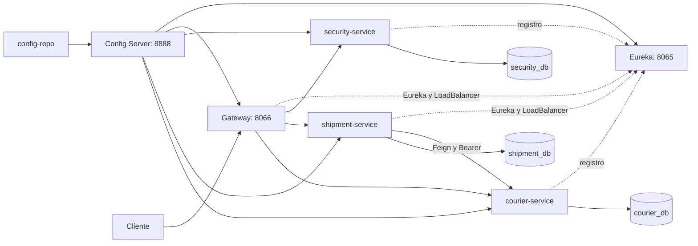

# Integracion del equipo - Sprint 3

La rama develop combina Eureka y Compose de Alex, Feign y resiliencia de Pablo,
y rutas, JWT/roles y CORS de Gonzalo. Los commits originales se conservan.
El manifiesto deploy/sprint3-sources.json identifica las fuentes compatibles de
los otros seis repositorios; shipment corresponde al checkout actual.

## Arquitectura



Security emite JWT RS256 con clave privada. Gateway, shipment y courier validan
localmente los tokens con la clave publica montada; la clave privada solo se
monta en security. El Gateway exige kid, issuer, audiencia y vigencia. Los
servicios mantienen sus controles de permisos y pertenencia.

## Contratos unificados

- Config Client es obligatorio en dev/prod. Las rutas y CORS del Gateway viven
  en config-repo y utilizan las propiedades actuales server.webflux de Cloud.
- El perfil sprint3 anuncia los nombres DNS de Compose y exige SERVICE_HOST y
  EUREKA_SERVER_URL. El cliente Feign usa courier-service, sin URL estatica.
- Gateway publica rutas /api/v1 de auth, usuarios, clientes, repartidores y
  envios. El locator generico esta desactivado para mantener una entrada definida.
- Actuator expone solamente salud, sin componentes ni endpoint de administracion
  de rutas. Los puertos de aplicaciones y bases de dominio son internos.
- Config Server verifica configuraciones de Gateway y Eureka en sprint3, usando
  la misma revision Git que sus clientes. Compose espera configuracion Git real.
- El healthcheck del Gateway espera que su catalogo local de Eureka contenga
  los tres servicios UP; el registro del servidor por si solo no garantiza que
  LoadBalancer ya tenga destinos disponibles al primer intento.
- Las seis aplicaciones se construyen como imagenes sprint3-local. No se
  sobrescriben los tags publicados del Sprint 2.

## Comprobacion reproducible

Seguir ARRANQUE-INFRAESTRUCTURA.md. La orden principal es:

```powershell
python integration/verify_sprint3.py --allow-courier-stop
```

Genera usuarios de prueba mediante ADMIN y verifica login real, ausencia/token
invalido 401, permisos 403, pertenencia entre identidades A/B, CORS, asignacion
por Feign/Eureka, repartidor inexistente 404, caida 503 sin modificar envio ni
historial, restauracion de courier y entrega por el repartidor asignado.
Despues de restaurar courier se espera salud UP estable del Gateway durante
35 segundos: un UP aislado puede preceder una respuesta antigua de la cache
de Eureka. La espera total esta limitada a 180 segundos.
Solo entonces comienza la siguiente comprobacion con Postman.

El workflow sprint3-stack.yml obtiene las revisiones del manifiesto, ejecuta
las suites de las seis aplicaciones y las pruebas de configuracion/Compose,
construye las imagenes y repite esa comprobacion con nueve contenedores reales.
Los artefactos conservados son target/sprint3/report.json y postman-results.xml,
sin requests, tokens ni entornos privados.
La retirada de volumenes de ese workflow solo afecta al runner descartable.

La primera ejecucion completa aprobada es
https://github.com/Logitrack-Sa/shipment-service/actions/runs/41753510385.
Comprueba las seis suites Java (437 pruebas), 11 contratos de configuracion,
cuatro contratos de Compose y el flujo distribuido. La cache auxiliar de JGit
se guarda en /tmp/.config para mantener la ejecucion sin privilegios.

## PR de integracion

- Configuracion: https://github.com/Logitrack-Sa/config-repo/pull/8
- Config Server: https://github.com/Logitrack-Sa/config-server/pull/11
- Gateway de Gonzalo: https://github.com/Logitrack-Sa/api-gateway/pull/3
- Ajustes de Gateway: https://github.com/Logitrack-Sa/api-gateway/pull/4
- Shipment, infraestructura y verificacion: https://github.com/Logitrack-Sa/shipment-service/pull/95

## Demostracion manual con Postman

Importar postman/LogiTrack_Sprint3.postman_collection.json (25 peticiones ordenadas).
La plantilla de entorno publica no incluye claves. Para preparar un entorno local:

```powershell
python integration/export_sprint3_postman.py
```

Importar target/sprint3/postman.environment.json solo en la instalacion local de
Postman y ejecutar las carpetas en orden. Ese archivo contiene credenciales y
esta excluido de Git. La coleccion obtiene los JWT reales durante la ejecucion,
crea sus propios datos y comprueba 200/201, 401, 403, 404 y CORS.
Tambien puede ejecutarse con Newman usando -e para ese entorno; guardar solo
el resumen JUnit de resultados, sin exportar requests, tokens o entornos.
La coleccion se ejecuto localmente con Newman 6.2.1: 25 peticiones y 35
aserciones aprobadas. El workflow distribuido repite la misma coleccion.

Usar http://localhost:8066 como base para todos los servicios. Iniciar sesion con
POST /api/v1/auth/login y JSON con email/password de la cuenta local; copiar
accessToken a Authorization > Bearer Token. Las credenciales se consultan solo
en el runtime.env privado de esa instalacion.

Con ADMIN: crear cliente, crear courier con DNI de ocho digitos, crear envio y
asignarlo con PUT /api/v1/shipments/{id}/courier. Con CLIENTE: consultar su envio
y comprobar 403 al listar usuarios. Con REPARTIDOR asignado: cambiar el estado
con PATCH /api/v1/shipments/{id}/status y JSON status=EN_RUTA o ENTREGADO.
Las cuentas de roles deben estar vinculadas a los UUID de cliente/repartidor
correspondientes mediante ADMIN; los identificadores no se inventan en el JWT.
