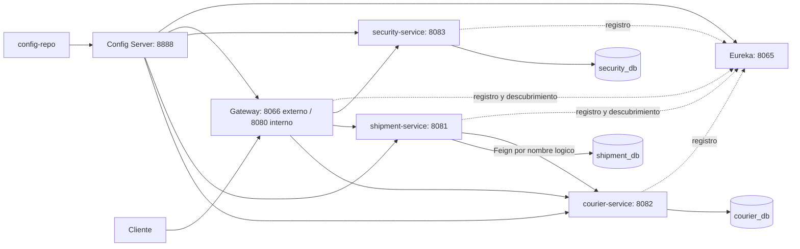

# Evidencia de infraestructura - 2 de noviembre de 2026

Este registro conserva la prueba inicial del 2 de noviembre. La arquitectura
unificada y sus instrucciones actuales se describen en INTEGRACION-UNIFICADA.md;
los pendientes y rutas de diagnostico de este registro corresponden a esa fecha.

## Resultado

Los nueve contenedores iniciaron con `deploy/docker-compose.yml` y quedaron
saludables. Config Server obtuvo la revision
`e996cd5f3374f38d0a1e3e19de152e8f5cedc29d` del repositorio Git de configuracion.
Eureka registro API-GATEWAY, SECURITY-SERVICE, COURIER-SERVICE y SHIPMENT-SERVICE
en estado UP, anunciando sus nombres DNS internos y puertos correctos.

Las bases usan volumenes y redes separados; las APIs de dominio no publican
puertos en el host. Solo security recibe la clave privada. Config y Eureka
publican sus puertos administrativos en loopback.

El healthcheck de Config Server consulta `/eureka-server/default`, ademas de
comprobar respuesta HTTP: su primera clonacion Git debe estar disponible antes
de iniciar los clientes. Un simple Actuator UP no garantizaba esa disponibilidad
en el HDD y podia provocar un timeout durante el bootstrap obligatorio.

El perfil sprint3 requiere SERVICE_HOST y EUREKA_SERVER_URL. Se retiraron los
defaults localhost detectados por el revisor IA para evitar direcciones de
descubrimiento incorrectas al omitir variables de despliegue.

## Prueba distribuida ejecutada

`python integration/verify_sprint3.py --discovery-routes --allow-courier-stop`
finalizo correctamente. El reporte local queda en `target/sprint3/report.json`;
no incluye credenciales ni tokens.

| Escenario real a traves del Gateway | Resultado |
|---|---|
| Login ADMIN | 200 y JWT |
| Consulta de envios sin Bearer | 401 del servicio protegido |
| Consulta con Bearer | 200 |
| Crear cliente, repartidor con DNI y envio | 201 |
| Asignar el repartidor mediante Feign y Eureka | 200 |
| Asignar un UUID de repartidor inexistente | 404 estructurado |
| Detener courier e intentar asignar | 503 estructurado |
| Comparar el envio antes/despues del fallo | Sin cambios |
| Restaurar courier | Saludable; nueve contenedores saludables al finalizar |

El modo discovery utiliza rutas temporales de la base del Gateway #80, por
ejemplo `/security-service/api/v1/auth/login`. No acredita que el Gateway valide
JWT: en esta base lo valida el servicio de destino. La prueba normal de rutas
publicas se ejecuto aparte y fallo con 404 en `POST /api/v1/auth/login`.

## Suites locales

| Proyecto | Pruebas aprobadas |
|---|---:|
| eureka-server: servidor HTTP, registro, heartbeat y baja | 2 |
| security-service | 106 |
| courier-service | 40 |
| shipment-service, incluyendo MySQL real con Testcontainers | 221 |
| api-gateway | 3 |
| Contratos de configuracion | 9 |
| Contratos de Compose | 4 |

Total: 372 pruebas Java y 13 pruebas Python, sin fallos. Maven package termino
correctamente en los cinco proyectos. Los tiempos de inicializacion MySQL en
HDD requirieron ampliar los healthchecks; solo las bases descartables de las
pruebas usan tmpfs, las bases del sistema conservan almacenamiento persistente.

## Cambios para revisar

- [Eureka PR 1](https://github.com/Logitrack-Sa/eureka-server/pull/1).
- [Configuracion PR 6](https://github.com/Logitrack-Sa/config-repo/pull/6).
- [Security PR 24](https://github.com/Logitrack-Sa/security-service/pull/24).
- [Courier PR 20](https://github.com/Logitrack-Sa/courier-service/pull/20).
- [Gateway PR 1](https://github.com/Logitrack-Sa/api-gateway/pull/1), sobre la base #80 de Gonzalo.
- [Shipment PR 93](https://github.com/Logitrack-Sa/shipment-service/pull/93), sobre la rama #86 de Pablo.

No se fusionan las ramas dependientes automaticamente ni se atribuye el trabajo
de los otros integrantes a Alex. Las imagenes Sprint 3 de esta prueba son locales.

## Pendientes del equipo

- #81: rutas publicas definitivas y propiedades nuevas de Spring Cloud Gateway.
- #82: validacion y permisos JWT en el Gateway.
- #83: politica CORS y sus pruebas.
- #88: matriz completa de roles y aceptacion integral de la arquitectura.
- #89: incorporar esta evidencia a la documentacion final del equipo.

La base del Gateway tambien registra avisos por propiedades renombradas y por
`management.endpoint.gateway.enabled`, ya no soportada. El servicio inicia y el
smoke pasa; la actualizacion de esas propiedades debe acompanar las rutas y
administracion del Gateway en sus issues.

El revisor IA de courier utiliza el checkout de main. Main contiene un gitlink
sin .gitmodules; el PR 20 lo elimina del indice sin borrar carpetas locales.
Las pruebas de codigo pasan, pero esa revision IA necesita que se integre la
correccion en su rama base para poder ejecutar el checkout.
